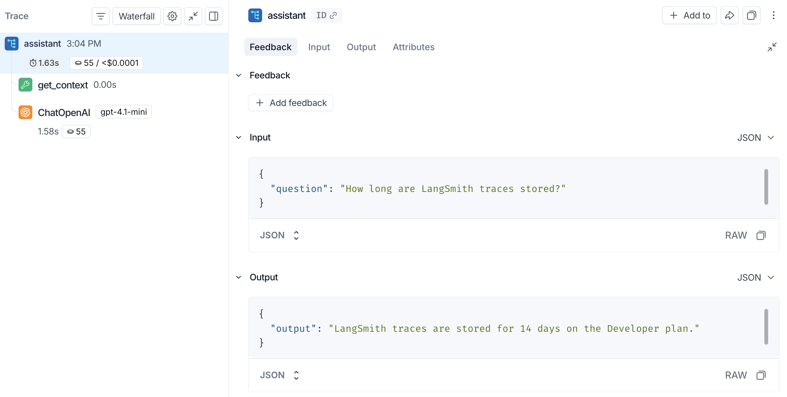

# 01 Quickstart: Send Your First Trace in 10 Minutes

> Sources: [Tracing quickstart](https://docs.langchain.com/langsmith/observability-quickstart) · [Create an API key](https://docs.langchain.com/langsmith/create-account-api-key) · [Log traces to an agent](https://docs.langchain.com/langsmith/log-traces-to-agent) · Verified 2026-10-28

**Goal**: Write a small assistant that "looks up context first, then asks Claude", and see its full execution in LangSmith.

## Prerequisites

| You need | How to get it |
|----------|---------------|
| LangSmith account | Sign up at [smith.langchain.com](https://smith.langchain.com); Google, GitHub, and email sign-in are supported |
| LangSmith API key | **Settings → API Keys → Create API Key**. The key is shown only once, so copy and save it |
| Model API key | This tutorial uses Anthropic ([Claude Console](https://platform.claude.com/settings/keys)); OpenAI and Gemini work the same way |
| Python | 3.10 or later |

### Which kind of API key should I use?

| Type | Permissions | Best for |
|------|-------------|----------|
| **Personal Access Token (PAT)** | Inherits your own permissions | Local scripts, learning, running evaluations |
| **Tracing key** | Can only upload traces; cannot read data | Production services (lower risk if leaked) |
| **Service key** | Scoped to certain workspaces or the whole organization | CI, background jobs |

For this tutorial series, a **PAT** is enough. A production service only needs to upload traces, so a Tracing key is safer.

## Step 1: Install dependencies

```bash
mkdir ls-quickstart && cd ls-quickstart
python -m venv .venv
# macOS / Linux
source .venv/bin/activate
# Windows PowerShell
# .venv\Scripts\Activate.ps1
pip install -U "langsmith>=0.14.9" anthropic
```

## Step 2: Set environment variables

**First, confirm your workspace type**: look at the top-left of the LangSmith web UI. If it shows agents, the workspace is organized by agent (the default for new Cloud workspaces); otherwise it is organized by project (older workspaces and self-hosted).

### Case A: Workspace organized by agent

1. In the web UI, click **+ Agent → Observability** and fill in **Agent name** and **Agent ID**. The ID cannot be changed after creation, so use a short English name such as `ls-quickstart`.
2. Set the environment variables:

```bash
# macOS / Linux
export LANGSMITH_TRACING=true
export LANGSMITH_API_KEY="<your-langsmith-api-key>"
export ANTHROPIC_API_KEY="<your-anthropic-api-key>"
export LANGSMITH_AGENT_ID="ls-quickstart"
export LANGSMITH_AGENT_ENVIRONMENT="local"   # local / development / staging / production
```

```powershell
# Windows PowerShell
$env:LANGSMITH_TRACING = "true"
$env:LANGSMITH_API_KEY = "<your-langsmith-api-key>"
$env:ANTHROPIC_API_KEY = "<your-anthropic-api-key>"
$env:LANGSMITH_AGENT_ID = "ls-quickstart"
$env:LANGSMITH_AGENT_ENVIRONMENT = "local"
```

> In this kind of workspace, **do not** also set `LANGSMITH_PROJECT`, `LANGCHAIN_PROJECT`, or `LANGCHAIN_SESSION`; they conflict with agent addressing.

### Case B: Workspace organized by project (including self-hosted)

No agent is needed; just use a project name (it is created automatically if it does not exist):

```bash
export LANGSMITH_TRACING=true
export LANGSMITH_API_KEY="<your-langsmith-api-key>"
export ANTHROPIC_API_KEY="<your-anthropic-api-key>"
export LANGSMITH_PROJECT="ls-quickstart"
```

### Not in the US region?

If your account is in another region, you must set `LANGSMITH_ENDPOINT`, otherwise the key will fail authentication:

| Region | `LANGSMITH_ENDPOINT` |
|--------|----------------------|
| GCP US (default) | `https://api.smith.langchain.com` |
| GCP EU | `https://eu.api.smith.langchain.com` |
| GCP APAC | `https://apac.api.smith.langchain.com` |
| AWS US | `https://aws.api.smith.langchain.com` |

If your key can access multiple workspaces, also set `LANGSMITH_WORKSPACE_ID` to choose which one to use.

## Step 3: Write the code

Create `app.py`:

```python
from anthropic import Anthropic
from langsmith import traceable
from langsmith.wrappers import wrap_anthropic

client = wrap_anthropic(Anthropic())  # every Anthropic call is traced automatically


@traceable(run_type="tool")  # show this step as a tool span
def get_context(question: str) -> str:
    # In a real app, this would query a knowledge base or vector store
    return "LangSmith traces are stored for 14 days on the Developer plan."


@traceable  # the whole pipeline becomes one trace
def assistant(question: str) -> str:
    context = get_context(question)
    response = client.messages.create(
        model="claude-sonnet-5-5",
        max_tokens=1024,
        system=f"Answer using the context below.\n\nContext: {context}",
        messages=[{"role": "user", "content": question}],
    )
    return "".join(block.text for block in response.content if block.type == "text")


if __name__ == "__main__":
    print(assistant("How long are LangSmith traces stored?"))
```

Two tools are used here:

- **`wrap_anthropic(...)`**: wraps the Anthropic client so the prompt, reply, token count, and cost of every model call are recorded.
- **`@traceable`**: decorates any function to record its inputs and outputs. When decorated functions call each other, they automatically form a parent-child nesting.

## Step 4: Run it and view the result

```bash
python app.py
```

Open LangSmith:

- **Case A**: select your agent → **Tracing** → choose the environment (`local`).
- **Case B**: open **Tracing** → project `ls-quickstart`.

Click the `assistant` row to open the trace:


*Figure: the execution tree is on the left; the input and output of the selected step are on the right (source: the official Tracing quickstart. The screenshot uses OpenAI; with Claude it shows as ChatAnthropic)*

What you can see:

- **Left execution tree**: `assistant` (1.63s total, 55 tokens) → `get_context` (tool) → model call.
- **Right detail pane**: each step's Input, Output, Feedback, and Attributes (metadata, tags, etc.).
- **Trajectory tab**: shows the messages actually sent to the model, in conversation form.

## Using LangChain / LangGraph? Even easier

Once the environment variables from Step 2 are set (`LANGSMITH_TRACING=true` + key + target), LangChain and LangGraph report traces automatically, with **no code changes**.

## Common Pitfalls

| Symptom | Cause / fix |
|---------|-------------|
| No trace appears in the web UI | Check that `LANGSMITH_TRACING=true` is set in **the same terminal that runs your code**; PowerShell and bash use different syntax |
| 401 / authentication failure | Your account is not in the US region but `LANGSMITH_ENDPOINT` is not set; or the key belongs to a different workspace |
| Traces land somewhere else | An agent workspace still has old variables such as `LANGSMITH_PROJECT` set; remove them |
| Short-lived processes (scripts, Lambda) lose traces | Traces are uploaded in batches in the background. Before the process exits, call `flush()` on **the client tracing actually uses**: if you did not pass a client, it is the global default client, so use `from langsmith.run_trees import get_cached_client; get_cached_client().flush()`. Note that creating a new `Client()` and flushing it does nothing |
| You do not want to record certain sensitive fields | See the "Redaction" section in [02 Observability](02_observability.md) |

## Next Steps

- To understand the different trace views and link multi-turn conversations together: [02 Observability](02_observability.md)
- To score your agent: [04 Evaluation](04_evaluation.md)
