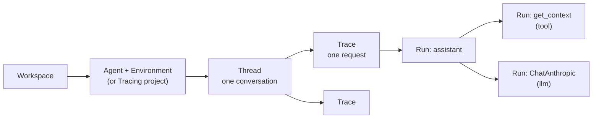
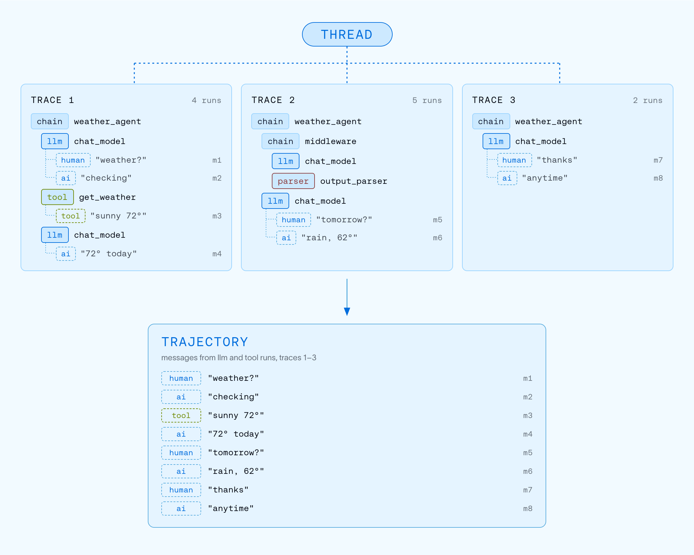
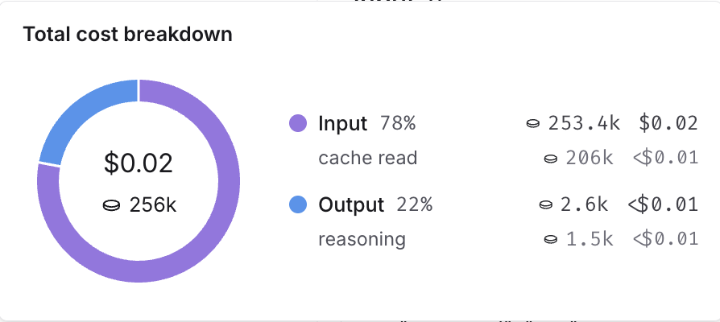
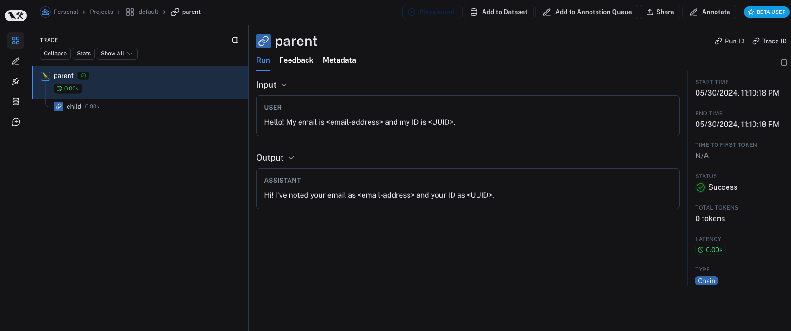

# 02 Observability: Understanding and Using Traces

> Sources: [Observability concepts](https://docs.langchain.com/langsmith/observability-concepts) · [View traces](https://docs.langchain.com/langsmith/view-traces) · [Filter traces](https://docs.langchain.com/langsmith/filter-traces) · [Configure threads](https://docs.langchain.com/langsmith/threads) · [Cost tracking](https://docs.langchain.com/langsmith/cost-tracking) · [Sampling](https://docs.langchain.com/langsmith/sample-traces) · [Mask inputs/outputs](https://docs.langchain.com/langsmith/mask-inputs-outputs) · Verified 2026-10-28

Prerequisite: you have completed [01 Quickstart](01_quickstart.md).

## 1. Trace Structure



- A **Run** is the smallest unit: one function call, one model call, or one retrieval. Runs are distinguished by `run_type`; common values are `chain` (default), `llm`, `tool`, `retriever`, `prompt`, `parser`, and `embedding`.
- A **Trace** is the complete execution tree of one request; its root node is called the root run.
- A **Thread** links multiple requests from the same conversation (you have to tag them yourself; see Section 3).

## 2. Three Ways to View a Trace

When you open a trace or thread, there are three tabs at the top:

| View | Use |
|------|-----|
| **Trajectory** | Conversation-style display: in each turn, what the model said, which tools it called, what the tools returned, plus token counts and cost. Good for **a quick scan** to spot abnormal tool results, odd sub-agent handoffs, and latency spikes |
| **Turns** | One card per turn showing only the root node's input and output; good for **seeing structure** |
| **Details** | For debugging: the full execution tree, with each run's input, output, metadata, latency, and errors. When you drill into a run, the surrounding conversation context stays visible |


*Figure: how Thread and Trajectory relate (source: Observability concepts)*

> On a trace page, press `Ctrl+I` (`Cmd+I` on Mac) to open **LangSmith Chat** and ask directly, "Why did this fail?" or "Which step was slowest?" See [08](08_engine_chat_sandbox.md) for details.

## 3. Hands-on: Add Metadata and Tags, and Link a Multi-turn Conversation into a Thread

Building on the code from 01, create `chat_app.py`:

```python
import uuid

from anthropic import Anthropic
from langsmith import traceable, tracing_context
from langsmith.wrappers import wrap_anthropic

client = wrap_anthropic(Anthropic())


@traceable(name="chat_turn", tags=["tutorial"])
def chat_turn(history: list[dict], user_message: str) -> str:
    messages = history + [{"role": "user", "content": user_message}]
    response = client.messages.create(
        model="claude-sonnet-5-5",
        max_tokens=512,
        messages=messages,
    )
    return "".join(block.text for block in response.content if block.type == "text")


def run_conversation() -> None:
    thread_id = str(uuid.uuid4())  # the docs recommend UUID v7 if available
    history: list[dict] = []
    for question in ["Hi, my name is Alex.", "What is my name?"]:
        # tracing_context applies the metadata to every run in this block,
        # including child runs; threads need thread_id on all of them
        with tracing_context(metadata={"thread_id": thread_id, "user_tier": "free"}):
            answer = chat_turn(history, question)
        history += [
            {"role": "user", "content": question},
            {"role": "assistant", "content": answer},
        ]
        print(f"> {question}\n{answer}\n")


if __name__ == "__main__":
    run_conversation()
```

After running it, go to the **Threads** tab in the web UI. You will see one thread containing two conversation turns.

Key points:

- The metadata key that marks a thread must be **`thread_id`** or **`session_id`**; the value can be any string.
- This metadata must be added to **all runs** (including child runs), otherwise filtering and token statistics will be inaccurate. Wrapping the whole call in `tracing_context` is the easiest way.
- Metadata and tags are **not** automatically propagated between parent and child runs. If you want to group both traces and LLM calls by metadata on a dashboard, both need it.
- You can also add metadata to a single call only: `chat_turn(history, q, langsmith_extra={"metadata": {...}})`.

## 4. Filtering and Searching

The search bar above the trace list supports a query syntax. Common examples:

| What you want | Query | Scope |
|---------------|-------|-------|
| LLM calls that are both slow and failing | `run_type:llm AND status:error AND latency:>10` | Runs |
| Runs an evaluator scored low | `run_type:llm AND feedback.correctness.score:<0.5` | Runs |
| Failed requests in production | `metadata.env:production AND -status:success` | Traces |
| Conversations that mention refunds and errored | `input:~"refund" AND status:error` | Threads |
| Requests that called a specific tool | `run_type:tool AND name:search_documents` | Traces + **Any run** |
| Requests that cost more than $0.50 | `total_cost:>0.5` | Traces |

Syntax cheat sheet:

| Syntax | Meaning |
|--------|---------|
| `field:value` / `-field:value` | Equals / does not equal |
| `field:~value` | Full-text search (the only form supported by `input`, `output`, `metadata`, and `error`) |
| `field:value*` | Wildcard |
| `field:*` / `-field:*` | Field exists / does not exist |
| `field:>10`, `field:[10 TO 20]` | Comparison and range (numeric and time fields) |
| `metadata.user_tier:free` | Use a dot to access a key inside JSON |
| `A OR B`, `A AND B` | Combine conditions |

Other tips:

- **Scope selector**: a condition can match only the root run (`in root run`), any run (`in any run`), or the whole thread (`in thread`).
- **AI search (Beta)**: search in natural language, for example "requests where the agent did not complete the task" or "conversations where the user seems very impatient". These conditions cannot be expressed in the query syntax.
- **Saved views**: save frequently used filters so everyone in the project can use them.
- **Filter within a single trace**: after opening a large trace, apply a filter; matching runs are highlighted and the rest of the structure is kept.

## 5. Cost and Tokens

After you use `wrap_anthropic` / `wrap_openai`, token counts and cost are calculated automatically, and hovering shows the breakdown:


*Figure: cost breakdown (source: Cost tracking)*

The built-in price table already covers most OpenAI, Anthropic, and Gemini models. If you use a self-hosted model or have negotiated pricing, add or override prices in the workspace's model price table (Settings → Models), or report token counts and cost yourself from code; see [Cost tracking](https://docs.langchain.com/langsmith/cost-tracking).

## 6. Controlling Volume: Sampling

With heavy traffic you don't need to record every request:

```bash
export LANGSMITH_TRACING_SAMPLING_RATE=0.1   # keep 10% of traces
```

You can also set different sampling rates for different `Client` instances: `Client(tracing_sampling_rate=0.25)`.

## 7. Protecting Sensitive Data

| Need | How |
|------|-----|
| Never upload inputs / outputs | Environment variables `LANGSMITH_HIDE_INPUTS=true`, `LANGSMITH_HIDE_OUTPUTS=true` |
| Do not upload metadata | `LANGSMITH_HIDE_METADATA=true` |
| Customize per function | `Client(hide_inputs=lambda inputs: {...}, hide_outputs=...)` |
| Regex replacement (emails, phone numbers, card numbers) | `langsmith.anonymizer.create_anonymizer`, see the example below |
| Stronger PII detection | Integrate Microsoft Presidio or Amazon Comprehend; the official docs have examples |

```python
from langsmith import Client, traceable
from langsmith.anonymizer import create_anonymizer

anonymizer = create_anonymizer([
    {"pattern": r"[a-zA-Z0-9._%+-]+@[a-zA-Z0-9.-]+\.[a-zA-Z]{2,}", "replace": "<email>"},
    {"pattern": r"\b\d{3}[-.\s]?\d{3}[-.\s]?\d{4}\b", "replace": "<phone>"},
])
client = Client(anonymizer=anonymizer)


@traceable(client=client)
def handle(text: str) -> str:
    return f"received: {text}"


handle("Call me at 555-123-4567 or mail alex@example.com")
```


*Figure: the result after hiding inputs and outputs (source: Prevent logging of sensitive data)*

## 8. Integrations

| Category | Supported (partial list) |
|----------|--------------------------|
| Frameworks | LangChain, LangGraph (just set environment variables); Deep Agents, CrewAI, Vercel AI SDK |
| Model SDKs | OpenAI, Anthropic, Gemini (`wrap_*` wrappers) |
| Agent SDKs | Claude Agent SDK, OpenAI Agents SDK |
| **Voice** | **Pipecat** (Beta, requires `langsmith[pipecat]`), LiveKit, OpenAI Realtime; see [Voice tracing fundamentals](https://docs.langchain.com/langsmith/trace-voice-fundamentals) |
| Coding agents | Sessions from Claude Code, OpenAI Codex, and Cursor can also be traced |
| General | OpenTelemetry; REST API; `@traceable` to wrap any function |

Full list: [Integrations](https://docs.langchain.com/langsmith/integrations).

## 9. Data Export and External Access

- **Bulk export**: export traces by project and date range to S3-compatible storage (Parquet format). There is also a guide for exporting to BigQuery; see [Bulk export](https://docs.langchain.com/langsmith/data-export).
- **Remote MCP**: LangSmith hosts an MCP server. Clients such as Claude Code and Cursor connect with OAuth or an API key and can query runs, prompts, and conversation history directly; see [Remote MCP](https://docs.langchain.com/langsmith/langsmith-remote-mcp).
- **LangSmith CLI**: view traces from the terminal; see [LangSmith CLI](https://docs.langchain.com/langsmith/langsmith-cli).

## Next Steps

- Once you have many traces, use dashboards and alerts to watch overall health: [03 Monitoring](03_monitoring.md)
- Turn the bad examples you find into a test set: [04 Evaluation](04_evaluation.md)
