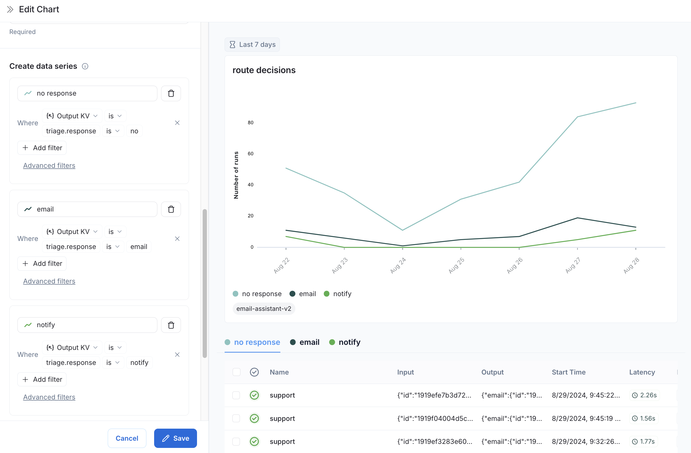
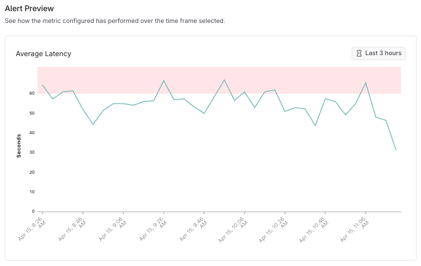
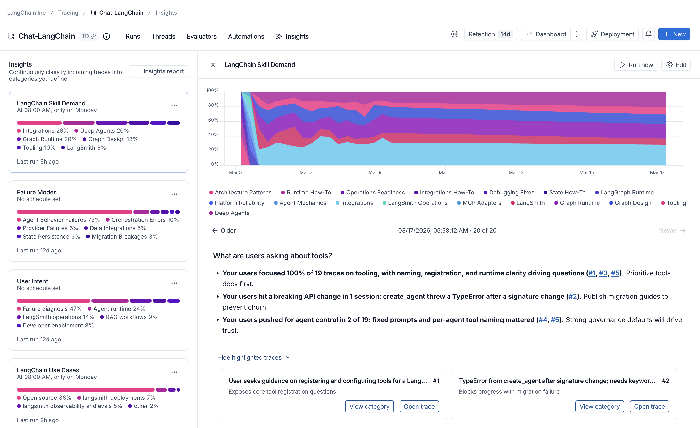

# 03 Monitoring: Dashboards, Alerts, Insights, Custom Apps

> Sources: [Dashboards](https://docs.langchain.com/langsmith/dashboards) · [Alerts](https://docs.langchain.com/langsmith/alerts) · [Insights](https://docs.langchain.com/langsmith/insights) · [Custom Apps](https://docs.langchain.com/langsmith/custom-apps) · Verified 2026-10-28

Individual traces are for debugging. This chapter is about **the big picture**: trends, anomalies, and what your users are actually doing.

| Tool | Question it answers | Plan |
|------|---------------------|------|
| Dashboards | What are the recent trends in error rate, latency, and cost? | — |
| Alerts | Will I find out right away when something breaks? | — |
| Insights | What are users asking? Which kinds of questions does the agent fail on? | Plus / Enterprise |
| Custom Apps | The built-in UI isn't enough; can I build my own? | Plus / Enterprise |

## 1. Dashboards

### Prebuilt dashboards (generated automatically)

Every tracing project (or every environment of an agent) has a prebuilt dashboard. Click the **Dashboard** button on the project page, or open it under **Monitoring** in the left sidebar:

| Section | Contents |
|---------|----------|
| Traces | Trace count, latency, error rate |
| LLM Calls | Number of model calls and their latency |
| Cost & Tokens | Total tokens / total cost, plus per-trace averages, broken down by token type |
| Tools | Call count, error rate, and latency of the 5 most-used tools |
| Run Types | Stats for the first-level runs under the root, to see which paths the agent mainly takes |
| Feedback Scores | Summary of the 5 most common feedback scores |

**Group by** in the top right lets you split by tag or metadata, for example comparing by `user_tier`, `model`, or `prompt_version`.

### Custom dashboards

**Monitoring → + New Dashboard → + New Chart**. You can start from a template, such as error-rate trend, average latency by model, call volume, token usage trend, or most expensive models; or define your own data series and filters:


*Figure: a custom chart split by routing result (source: Dashboards)*

> Note: the new custom dashboards are available in Cloud US; the EU / APAC regions use the legacy version, whose UI differs slightly.

## 2. Alerts

### Metrics you can alert on

| Metric | Example |
|--------|---------|
| **Errors** | More than 5% of runs error within 5 minutes (error count or error rate both work) |
| **Latency** | Average latency suddenly increases |
| **Cost** | Spend exceeds expectations (requires cost tracking to be enabled) |
| **Feedback Score** | The average of user feedback or an online evaluator drops |
| **Run Count** | Abnormal call volume (for example, traffic suddenly stops, which suggests an upstream outage) |

### Setup steps

1. Open the tracing project to monitor (in an agent workspace, open one of the agent's environments, such as production).
2. Create an alert and choose the metric type. Errors and Latency can also be combined with filters, for example to watch only one tool or one tag.
3. Set the condition:
   - **Aggregation**: average, percentage, or count
   - **Comparison**: `>=`, `<=`
   - **Threshold**
   - **Time window**: 5 minutes or 15 minutes
4. Check the **preview** first: it simulates the alert on historical data, and red dots mark the times it would have fired. Use it to tune the threshold so the alert isn't too noisy.
5. Choose a notification channel: **Slack**, **PagerDuty**, **Dynatrace**, or any **Webhook** (the official docs provide configuration examples for several common receivers).


*Figure: alert preview (source: Alerts)*

> Alerts are **configured per project (or per environment)**, so to monitor several projects you must set them up separately. The advantage of an agent workspace is that alerts watch only production, so traces from local debugging won't trigger false alarms.

## 3. Insights

Insights automatically analyzes large numbers of traces and **categorizes them hierarchically**, telling you what users mainly do and what common behaviors and failure modes the agent shows, without reading traces one by one.

### Generate a report in the UI

1. In the workspace settings, first configure a model for Insights (model configuration).
2. **Tracing** → select a project (or an agent environment) → **+New → New Insights Report** in the top right.
3. Give it a name, answer the guiding question (for example, "I want to know what problems users hit most often"), and click **Run job**.
4. The report is generated in the background and takes **up to about 30 minutes**.


*Figure: an Insights report (source: Insights)*

### Analyzing data from outside LangSmith

Existing chat histories (for example, exported from a database) can also be uploaded with the SDK to generate a report:

```python
import os

from langsmith import Client

client = Client()

chat_histories = [
    [
        {"role": "user", "content": "I was charged twice for my order"},
        {"role": "assistant", "content": "Sorry about that, let me check the payment."},
    ],
    [
        {"role": "user", "content": "How do I change my delivery address?"},
        {"role": "assistant", "content": "You can edit it under Orders > Details."},
    ],
]

report = client.generate_insights(
    chat_histories=chat_histories,
    name="Support topics - October",
    instructions="What are the main topics and problems users ask about?",
    openai_api_key=os.environ["OPENAI_API_KEY"],  # optional if set as a workspace secret
)
```

The SDK first uploads the chat histories as traces to a new project, then generates the report on top of them, and finally returns a link to the report.

### How do Insights and Engine differ?

| | Insights | Engine |
|---|----------|--------|
| Purpose | An analysis tool | A tool for fixing problems |
| Output | Categories + metrics per category, for usage patterns and changes over time | Concrete issues: diagnosis, related traces, suggested fixes (can open a PR directly) |
| Best for | Understanding "how people use it" | Finding "what's broken and how to fix it" |

See [08](08_engine_chat_sandbox.md) for Engine.

## 4. Custom Apps

When the built-in UI can't support a particular workflow (such as a dedicated annotation page, an experiment-comparison page tailored to your business, or a dashboard showing only your team's data), you can build a **Custom App**:

- It runs inside LangSmith and calls the LangSmith API. It appears under **Custom Apps** in the left sidebar, with no separate service to deploy and no login to build.
- You can ask LangSmith Chat to build it for you in conversation, or develop locally with the LangSmith CLI.
- It runs in a sandbox without Internet access, and API requests carry the permissions of **the person currently viewing it**, so each person sees only the data they are allowed to see.

For details, see [Custom Apps](https://docs.langchain.com/langsmith/custom-apps).

## Next Steps

- Have production traces scored automatically and routed into annotation queues: [05 Online Evaluation, Automation, and Human Annotation](05_online_eval_feedback.md)
