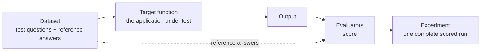
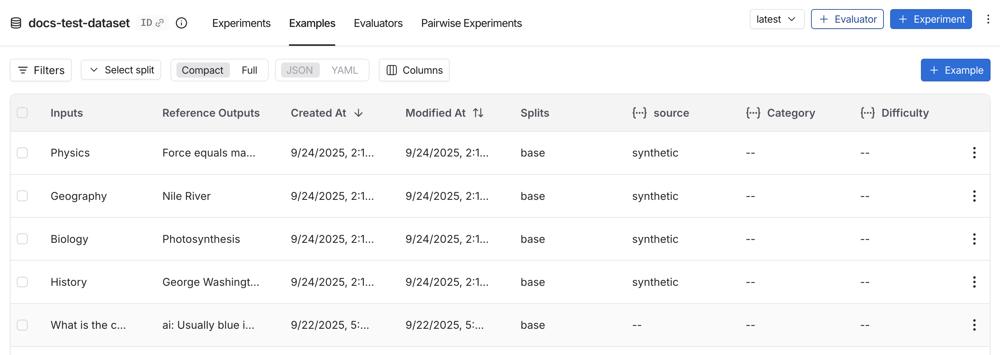
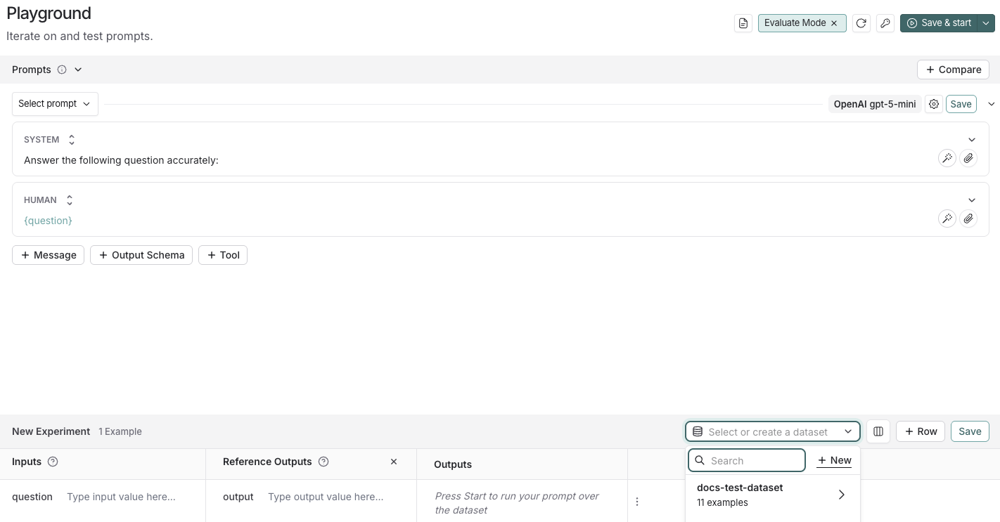
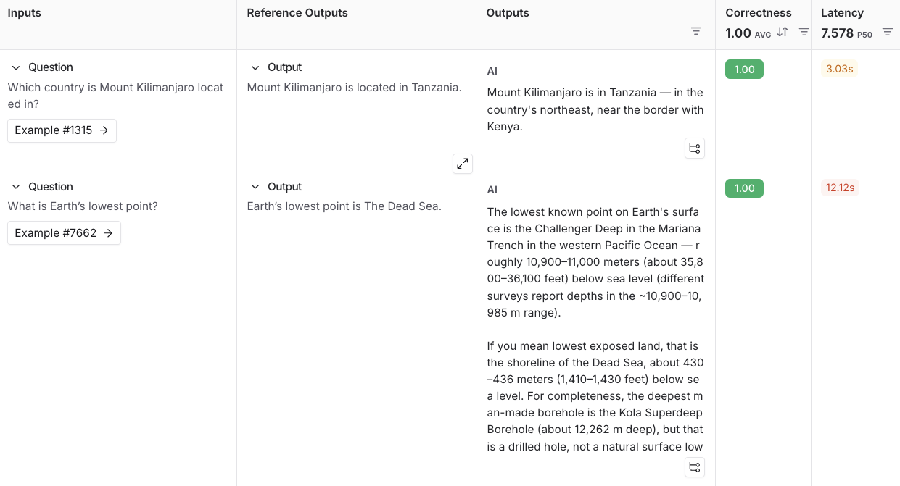
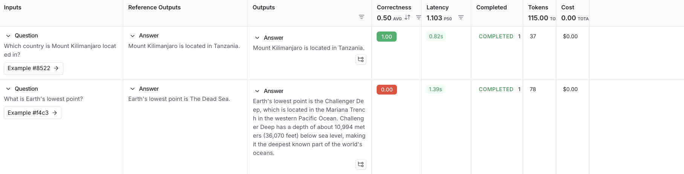
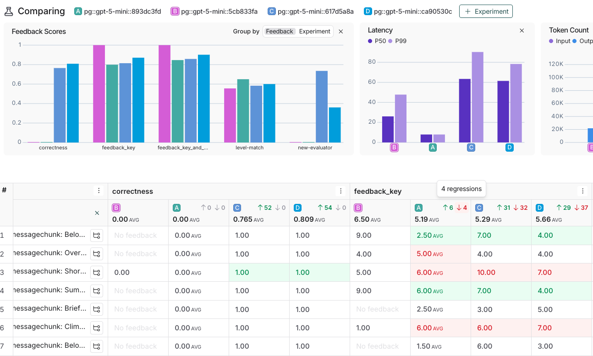
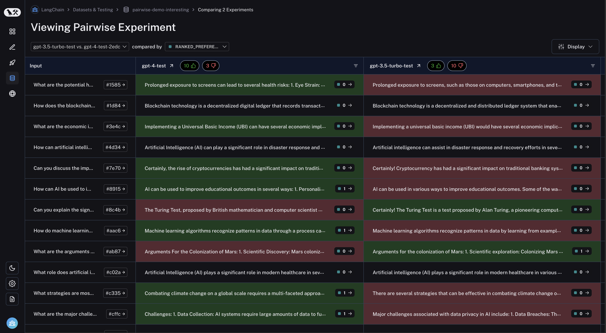
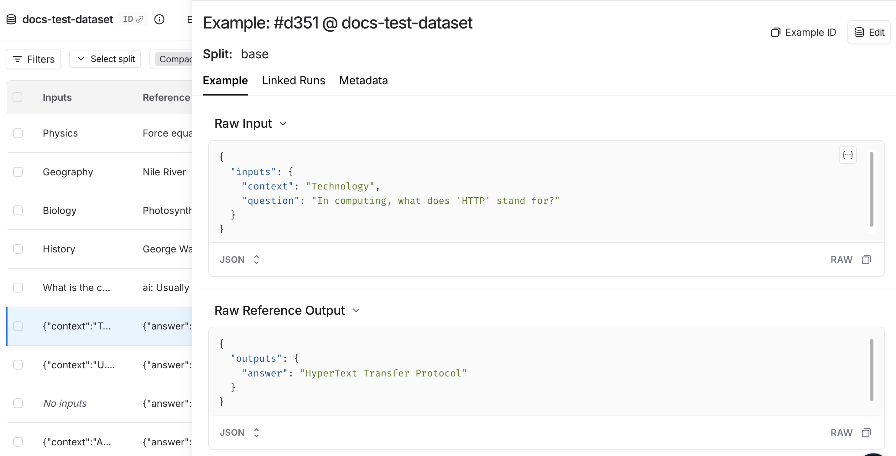

# 04 Evaluation: Scoring Your Agent with Datasets

> Sources: [Evaluation quickstart](https://docs.langchain.com/langsmith/evaluation-quickstart) · [Evaluation concepts](https://docs.langchain.com/langsmith/evaluation-concepts) · [Compare experiment results](https://docs.langchain.com/langsmith/compare-experiment-results) · [Pairwise evaluation](https://docs.langchain.com/langsmith/evaluate-pairwise) · Verified 2026-10-28

LLM output is non-deterministic. Changing a prompt or switching models can make results better or worse. Evaluation turns "it feels better" into numbers you can compare, by using **the same set of test questions and the same scoring criteria**.

## 1. Three Building Blocks



| Building block | Description |
|----------------|-------------|
| **Dataset** | A set of examples; each has `inputs` and optionally `outputs` (reference answers) |
| **Target function** | The thing under test: a single model call, a module, or a whole agent |
| **Evaluators** | Scoring functions: code rules, LLM-as-judge, human annotation, pairwise comparison |
| **Experiment** | The result of one version of the target running over the whole dataset and being scored; it can be compared with other experiments |


*Figure: the Datasets page (source: Evaluation concepts)*

There are two routes: **A. Click through the web UI** (no code; good for testing prompts) and **B. Use the SDK** (good for testing a full application and wiring into CI).

---

## Route A: Evaluate a Prompt in the Web UI

### A1. Configure a model key

**Settings → Integrations → Provider secrets → + Secret**, choose a Provider (for example Anthropic), enter the key, and save. LangSmith stores it under a name such as `ANTHROPIC_API_KEY`. If you lack permission, ask a workspace admin.

### A2. Write the prompt

In the left sidebar, open **Playground** and change the system prompt to:

```
Answer the following question accurately:
```

Leave the Human message as `{question}`.

### A3. Create a dataset

1. Click **Set up Evaluation**; a **New Experiment** table appears at the bottom of the page.
2. In the **Select or create a new dataset** dropdown, click **+ New**.


*Figure: creating a dataset in the Playground (source: Evaluation quickstart)*

3. Add two examples:

| Inputs | Reference Outputs |
|--------|-------------------|
| question: Which country is Mount Kilimanjaro located in? | output: Mount Kilimanjaro is located in Tanzania. |
| question: What is Earth's lowest point? | output: Earth's lowest point is The Dead Sea. |

4. **Save** and give the dataset a name.

### A4. Add an evaluator and run

1. **+ Evaluator → Prebuilt Evaluator → Correctness → Save**.
2. Click **Start** in the top right to produce an experiment. Click the experiment name to see the full results:


*Figure: the full Experiment view (source: Evaluation quickstart)*

---

## Route B: Evaluate an Application with the SDK

### B1. Install and set environment variables

```bash
mkdir ls-eval && cd ls-eval
python -m venv .venv
source .venv/bin/activate        # Windows: .venv\Scripts\Activate.ps1
pip install -U langsmith anthropic openevals langchain-anthropic
```

The environment variables are the same as in [01](01_quickstart.md): `LANGSMITH_TRACING=true`, `LANGSMITH_API_KEY`, `ANTHROPIC_API_KEY`. If your key can access multiple workspaces, also set `LANGSMITH_WORKSPACE_ID`.

> `openevals` is LangChain's open-source evaluator library. It includes common judging prompts for correctness, conciseness, hallucination, and more. Using Claude as the judge model requires `langchain-anthropic`.

### B2. Create the dataset: `dataset.py`

```python
from langsmith import Client

DATASET_NAME = "ls-tutorial-qa"

EXAMPLES = [
    {
        "inputs": {"question": "Which country is Mount Kilimanjaro located in?"},
        "outputs": {"answer": "Mount Kilimanjaro is located in Tanzania."},
    },
    {
        "inputs": {"question": "What is Earth's lowest point?"},
        "outputs": {"answer": "Earth's lowest point is the Dead Sea."},
    },
    {
        "inputs": {"question": "Who wrote 'Pride and Prejudice'?"},
        "outputs": {"answer": "Jane Austen wrote 'Pride and Prejudice'."},
    },
]


def main() -> None:
    client = Client()
    if client.has_dataset(dataset_name=DATASET_NAME):
        print("Dataset already exists:", DATASET_NAME)
        return
    dataset = client.create_dataset(
        dataset_name=DATASET_NAME,
        description="Tutorial QA dataset",
    )
    client.create_examples(dataset_id=dataset.id, examples=EXAMPLES)
    print("Created dataset:", dataset.name)


if __name__ == "__main__":
    main()
```

```bash
python dataset.py
```

### B3. Write the target and evaluators: `eval.py`

```python
from anthropic import Anthropic
from langsmith import Client
from langsmith.wrappers import wrap_anthropic
from openevals.llm import create_llm_as_judge
from openevals.prompts import CORRECTNESS_PROMPT

anthropic_client = wrap_anthropic(Anthropic())

SYSTEM_PROMPT = "Answer the following question accurately."


# Target: receives each example's inputs, returns a dict of outputs
def target(inputs: dict) -> dict:
    response = anthropic_client.messages.create(
        model="claude-sonnet-5-5",
        max_tokens=512,
        system=SYSTEM_PROMPT,
        messages=[{"role": "user", "content": inputs["question"]}],
    )
    text = "".join(block.text for block in response.content if block.type == "text")
    return {"answer": text.strip()}


# Code evaluator: cheap and deterministic
def concise(outputs: dict) -> bool:
    return len(outputs["answer"]) < 300


# LLM-as-judge evaluator from openevals
correctness_judge = create_llm_as_judge(
    prompt=CORRECTNESS_PROMPT,
    model="anthropic:claude-haiku-5-5",
    feedback_key="correctness",
)


def correctness(inputs: dict, outputs: dict, reference_outputs: dict):
    return correctness_judge(
        inputs=inputs,
        outputs=outputs,
        reference_outputs=reference_outputs,
    )


def main() -> None:
    client = Client()
    results = client.evaluate(
        target,
        data="ls-tutorial-qa",
        evaluators=[concise, correctness],
        experiment_prefix="sonnet-baseline",
        max_concurrency=2,
    )
    print(results)


if __name__ == "__main__":
    main()
```

How to write evaluators:

- Arguments are injected by name. You can use `inputs`, `outputs`, `reference_outputs` (and also `run`, `example`); declare only the ones you need.
- Return a `bool`, a number, or a dict such as `{"key": ..., "score": ...}`.
- When no key is specified, **the function name becomes the metric name** (`concise` above).

### B4. Run it and view the results

```bash
python eval.py
```

The terminal prints a link; open it to see this experiment:


*Figure: Experiment results (source: Evaluation quickstart)*

---

## 2. Comparing Experiments: Did the Change Make Things Better or Worse?

Evaluation really pays off when you **compare**. For example, change `SYSTEM_PROMPT` in `eval.py` to `"Answer in one short sentence."`, change `experiment_prefix` to `"sonnet-short"`, and run it again.

Then in the web UI: **Datasets → ls-tutorial-qa → Experiments**, check both experiments → **Compare**.


*Figure: comparing multiple experiments, with regressions in red and improvements in green (source: Compare experiment results)*

In the comparison view you can:

- **Set a baseline**: pick one experiment as the source and compare the others against it.
- **Set a direction**: for each metric, specify "higher is better" or "lower is better" so red and green are correct.
- **Diff mode**: compare the two outputs word by word.
- **Expand a single row**: see the full trace of one example across all experiments.
- **Chart by metadata**: for example, put the model or prompt version on the x-axis.

## 3. Evaluator Types

| Type | Best for | Examples |
|------|----------|----------|
| **Code / rules** | Clear-cut criteria | Length, whether the output is valid JSON, whether a specific tool was called, exact match with the reference answer |
| **LLM-as-judge** | Judgments that require "understanding" | Correctness, hallucination, appropriate tone |
| **Human** | Criteria that are hard to automate, or for calibrating a judge model | Use [Annotation Queues](05_online_eval_feedback.md#3-human-annotation-annotation-queues) |
| **Pairwise** | Absolute scores are hard to assign but you can tell which is better | Two versions of a reply; have a judge model or a person pick A / B |
| **Summary evaluator** | Metrics computed over the whole dataset | precision, recall, F1 |

### Pairwise Comparison


*Figure: the Pairwise experiment view (source: Pairwise evaluation)*

How it works: first run the two experiments separately, then pass the two experiment names to `evaluate` as a tuple along with a comparative evaluator. For the code, see [Pairwise evaluation](https://docs.langchain.com/langsmith/evaluate-pairwise).

## 4. Where Datasets Come From

| Source | How |
|--------|-----|
| Handwritten | Add directly in the web UI, or use the SDK as above |
| Production traces | Click **Add to → Dataset** on a trace page; or use an [automation rule](05_online_eval_feedback.md) to add matching traces automatically |
| Files | Upload CSV / JSONL in the web UI |
| Engine | Issues found by Engine can be turned into test data with one click; see [08](08_engine_chat_sandbox.md) |

Datasets are versioned automatically, can be divided into splits (for example `train` and `test`), and can have a schema defined for inputs / outputs.


*Figure: a single example (source: Evaluation concepts)*

## Common Pitfalls

| Symptom | Cause / fix |
|---------|-------------|
| The evaluator can't get the reference answer | The `outputs` field name in the dataset must match the key the evaluator reads (both use `answer` in this example) |
| Runs are very slow or rate-limited | Lower `max_concurrency`; LLM-as-judge also calls a model, and it counts toward the rate limit |
| LLM-as-judge scores are unreliable | Hand-label a small batch first, compare against the judge model's results, then tune the prompt; you can add few-shot examples in openevals |
| The dataset is recreated on every run | Check with `client.has_dataset(...)` first, as `dataset.py` does |
| Does evaluation cost money? | Every run in an experiment also produces a trace; LLM-as-judge additionally consumes model-call costs |

## Next Steps

- Attach evaluators to production traffic: [05 Online Evaluation](05_online_eval_feedback.md)
- Let LangSmith manage your prompts and test changes directly: [06 Prompt & Context Hub](06_prompt_engineering.md)
