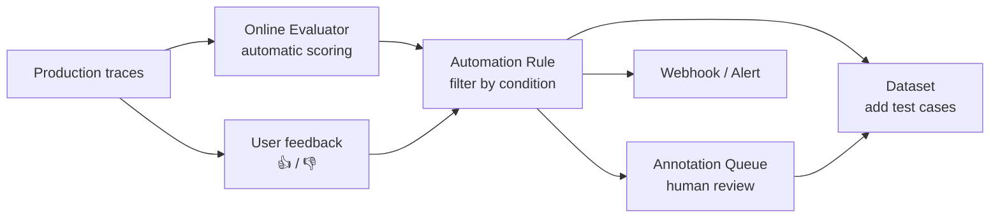
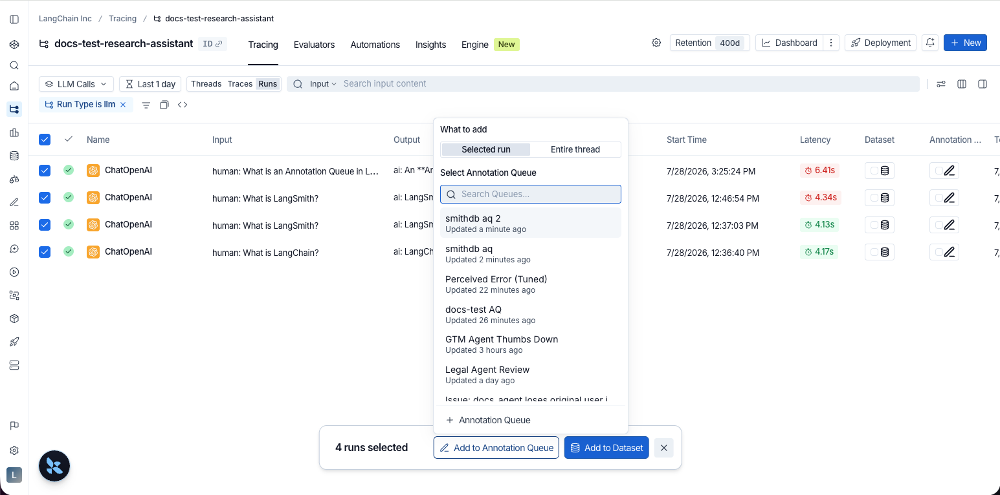
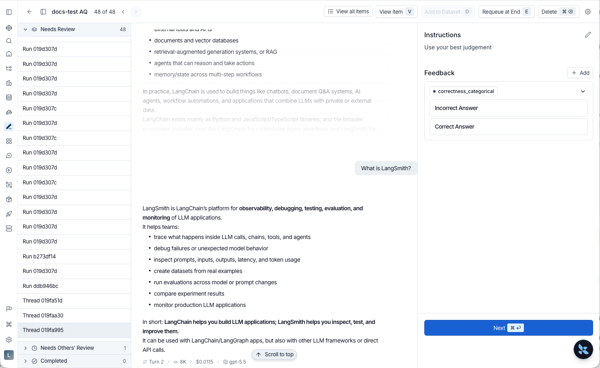
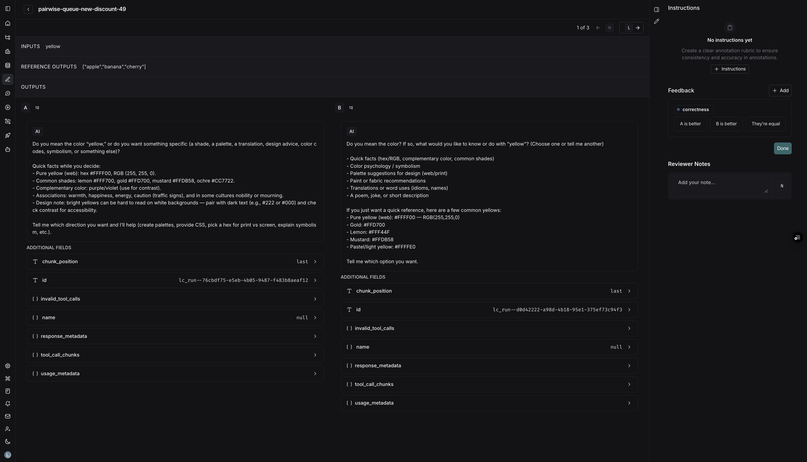

# 05 Online Evaluation, Automation Rules, and Human Annotation

> Sources: [Online LLM-as-judge](https://docs.langchain.com/langsmith/online-evaluations-llm-as-judge) · [Online code evaluators](https://docs.langchain.com/langsmith/online-evaluations-code) · [Multi-turn](https://docs.langchain.com/langsmith/online-evaluations-multi-turn) · [Composite](https://docs.langchain.com/langsmith/online-evaluations-composite) · [Automation rules](https://docs.langchain.com/langsmith/rules) · [Annotation queues](https://docs.langchain.com/langsmith/annotation-queues) · [User feedback](https://docs.langchain.com/langsmith/attach-user-feedback) · Verified 2026-10-28

[04](04_evaluation.md) covered scoring against a fixed dataset **before release** (offline evaluation). This chapter covers **after release**:



## 1. Online Evaluators: Automatically Scoring Production Traces

### Four types

| Type | What it does | Typical use |
|------|--------------|-------------|
| **LLM-as-judge** | Scores a single run with a model | Whether the answer is on topic, hallucination, tone |
| **Code** | Scores a single run with code | Whether the output is valid JSON, length, whether it contains banned words |
| **Multi-turn** | Scores an **entire conversation** (thread) | Whether the user's problem was finally resolved, whether the user is unhappy |
| **Composite** | Combines scores from multiple evaluators into one by weight (weighted average or weighted sum) | "Overall quality score" = correctness × 0.6 + tone × 0.4 (weighted average) |

### Set up an LLM-as-judge evaluator

1. **Tracing** → select a project (or the agent's production environment) → **Evaluators** tab.
2. **+ Evaluator**, then choose one of three:
   - **Create from scratch** → LLM-as-a-Judge Evaluator
   - **Attach an existing evaluator**: reuse one already in the workspace
   - **Create from a template**: start from a ready-made template
3. Give it a name, write the judging prompt, and choose the judge model (you must first configure the key in Provider secrets).
4. **Add filters** so that only the runs you need are evaluated. For example:
   - Runs the user gave a thumbs-down
   - Runs that called a particular tool
   - Runs whose metadata matches (for example, evaluate only customers with `plan_type=enterprise`)
   - Runs where another evaluator's score is below a threshold (chained evaluation)
5. **Set a sampling rate**: for example, evaluate only 10% to control cost.
6. (Optional) **Apply to historical runs**: backfill existing traces.

> ⚠️ **Cost warning**: traces that run through an online evaluator are **automatically upgraded to extended retention (180 days)**, which has a higher unit price; the judge model calls also cost money. Start with a low sampling rate and raise it once you've confirmed it's useful. You can set a spending cap in [Evaluator spend](https://docs.langchain.com/langsmith/evaluator-spend).

### Multi-turn evaluation

Multi-turn evaluators operate on **threads**, and require traces to carry `thread_id` / `session_id` metadata (see [Section 3 of 02](02_observability.md#3-hands-on-add-metadata-and-tags-and-link-a-multi-turn-conversation-into-a-thread)). After the last trace arrives, LangSmith waits for the **idle time** you configured to pass, treats the conversation as finished, and then evaluates the whole conversation. So each thread is evaluated only once, not once per trace.

## 2. Automation Rules: Process Traces Automatically by Condition

A rule = **filter condition** + **sampling rate** + **action**.

| Action | Example |
|--------|---------|
| Add to Annotation Queue | Send all thumbs-down traces to human review; randomly sample 10% for spot checks |
| Add to Dataset | Traces with errors automatically go into the regression test set |
| Trigger Webhook | Push low-scoring traces to your service (for example, for remote evaluation or to file a ticket) |
| Run online evaluator / code evaluator | See the previous section |
| Extend data retention | Upgrade errored traces to extended retention for later investigation |
| Trigger Alert | See [03](03_monitoring.md) |

### Things to watch for when setting up

- **Item Type**: choose **Runs** or **Threads**. With Runs, each run is processed as it arrives; with Threads, processing waits until the conversation ends (and only add-to-annotation-queue, add-to-dataset, or trigger-webhook are available).
- **There is no guaranteed ordering between rules**: each rule polls independently. If a webhook needs to carry an evaluation score, don't count on the evaluation rule running first. Instead, add a feedback filter to the webhook rule, such as triggering only when `feedback.correctness.score` exists.
- When one rule has multiple actions, they run in a fixed order: annotation queue → dataset → webhook → online evaluator → code evaluator → extend retention → alert.

## 3. Human Annotation (Annotation Queues)

### Create a queue

1. In the left sidebar, **Annotation Queues → + Annotation Queue**.
2. Fill in **Name** and **Description**; you can choose a **default dataset** so reviewed items can be saved to it in one click.
3. Write **Instructions** (annotation guidelines, shown in the sidebar for every item).
4. **+ Add a feedback rubric**: define the scores to give, such as `correctness` (0/1) or `tone` (good / neutral / bad), and spell out what each one means.

### Add items to the queue

| From where | How |
|------------|-----|
| A single run | In the trace's Details view, on the run's title bar: **Add to → Add to Annotation Queue** |
| A whole conversation | In the Details view, click the "add to queue" icon next to the Trajectory / Turns / Details tabs (requires thread metadata) |
| In bulk | Multi-select in the run list or Threads list, then **Add to Annotation Queue** at the bottom |
| Experiment results | Select the experiment, then **Annotate** at the bottom |
| Automatically | Use an Automation Rule from the previous section |


*Figure: adding items to an annotation queue in bulk (source: Annotation queues)*

### Review

Open the queue and review items one by one: the conversation or run is shown in the middle, with the annotation instructions and rubric items on the right. Give scores, write notes, mark as reviewed, or **Add to Dataset** to save it as a test case.


*Figure: reviewing a conversation (source: Annotation queues)*

### Pairwise queues (A/B comparison)

Select two experiments → **Add to Pairwise Annotation Queue**. During review, the outputs of the two versions are shown side by side; choose **A / B / Equal**. Keyboard shortcuts are supported. This suits cases where "it's hard to give an absolute score, but you can tell which is better".


*Figure: the Pairwise review interface (source: Annotation queues)*

## 4. Recording User Feedback from Code

Add 👍 / 👎 buttons to your product and record the user's rating on the trace. You can then filter by feedback, alert on it, or send items to human review.

```python
import asyncio

from langsmith import Client, trace, traceable

client = Client()


@traceable
def answer(question: str) -> str:
    return f"Here is how to handle: {question}"  # call your model here


question = "Reset my password"
with trace(name="support_request", inputs={"question": question}) as root_run:
    root_run.outputs = {"answer": answer(question)}

# Feedback needs the trace's session (project) ID
if root_run.address is not None:  # agent-based workspace
    session_id = asyncio.run(client.sessions.resolve(**root_run.address)).session_id
else:  # project-based workspace
    session_id = client.read_project(project_name=root_run.session_name).id

# Later, when the user clicks thumbs up in your UI
client.create_feedback(
    key="user_thumb",
    score=1,
    comment="The steps worked",
    trace_id=root_run.id,
    session_id=session_id,
)
```

Key points:

- In a real web app, when you respond to the user, return the `trace_id` and `session_id` to the frontend, and call `create_feedback` when the user clicks the button.
- **Always pass `trace_id`**: feedback can be uploaded in batches in the background without blocking the request.
- **Pass `session_id` too**: the SDK docs state that run-level feedback without `session_id` is deprecated.
- Use `score` for a number or boolean; `value` can hold a category (for example `"too_long"`); `comment` holds free-text notes.

## Next Steps

- Hand problems found in production to Engine for automatic diagnosis: [08](08_engine_chat_sandbox.md)
- Let LangSmith manage your prompts: [06 Prompt & Context Hub](06_prompt_engineering.md)
