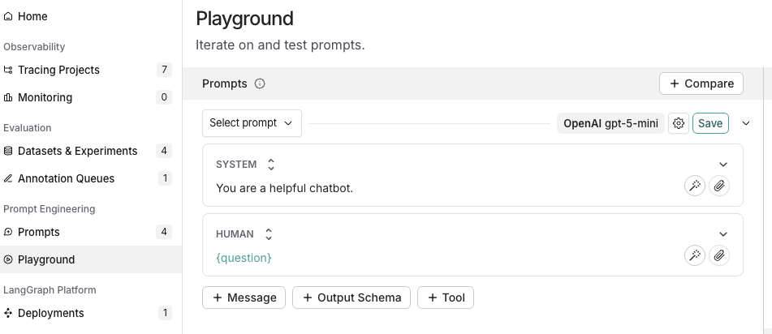
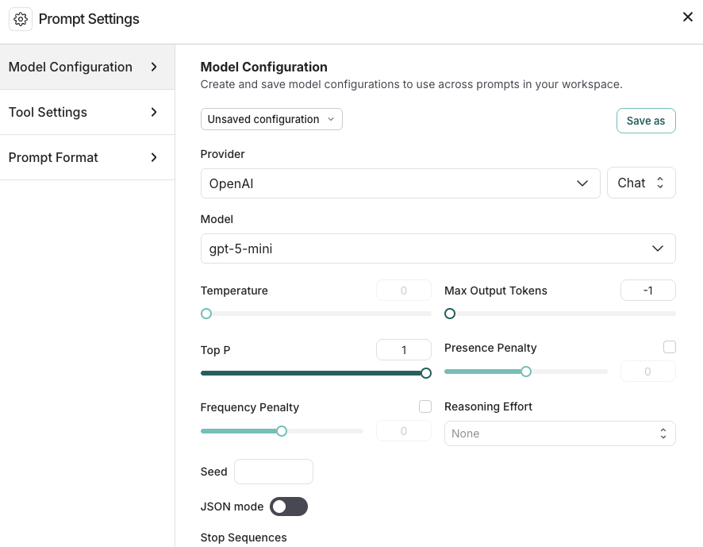
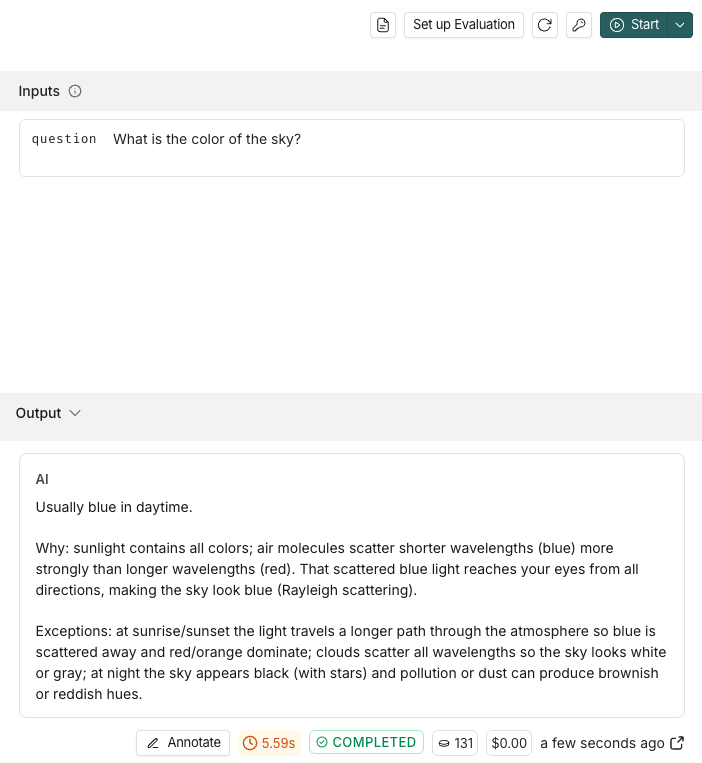
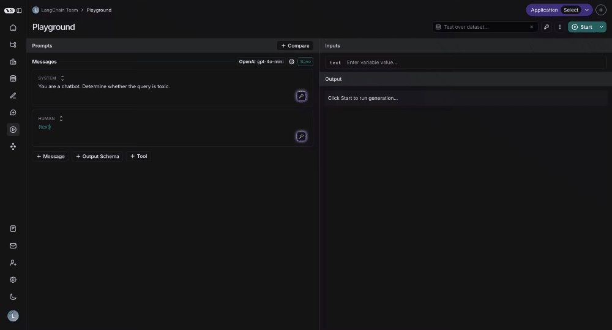

# 06 Prompt & Context Hub: Manage Prompts Outside Your Code

> Sources: [Prompt & Context Hub](https://docs.langchain.com/langsmith/prompt-context-hub) · [Prompt engineering quickstart](https://docs.langchain.com/langsmith/prompt-engineering-quickstart) · [Manage prompts](https://docs.langchain.com/langsmith/manage-prompts) · [Manage prompts programmatically](https://docs.langchain.com/langsmith/manage-prompts-programmatically) · [Context engineering concepts](https://docs.langchain.com/langsmith/context-engineering-concepts) · [Manage contexts with the SDK](https://docs.langchain.com/langsmith/manage-contexts-sdk) · Verified 2026-10-28

**Why do this?** Prompts, retrieval context, and skill instructions change more often than code, and they are often edited by non-coders such as product and operations people. Once you manage them in LangSmith:

- Every edit is a **commit**, so you can view diffs and roll back.
- You publish through two environments, **Staging / Production**, and code pulls by environment, so **changing a prompt needs no redeploy**.
- After an edit, you can run it over a dataset in the Playground right away and confirm nothing got worse before publishing.

The Hub has two parts:

| | Prompts | Context Hub |
|---|---------|-------------|
| What it manages | A single message template (system + user …) | A whole instruction bundle: a skill, or the complete configuration of an agent |
| Typical contents | `ChatPromptTemplate` | Files such as `AGENTS.md`, `SKILL.md`, `tools.json` |
| SDK | `push_prompt` / `pull_prompt` | `push_agent` / `pull_agent`, `push_skill` / `pull_skill` |

---

## 1. Create and Test a Prompt in the Web UI

### 1.1 Configure a model key

**Settings → Integrations → Provider secrets → + Secret**, choose a Provider, and enter the key.

### 1.2 Create a new prompt

In the left sidebar, **Prompts → + Prompt**, then edit the messages and variables (use curly braces such as `{question}` for variables).


*Figure: creating a new prompt (source: Prompt engineering quickstart)*

### 1.3 Choose a model and try it

1. Click the gear next to the model name to open **Model Configuration**: choose the Provider and Model, and adjust parameters such as temperature, max tokens, and reasoning effort.


*Figure: model configuration (source: Prompt engineering quickstart)*

2. Fill in the variable values under **Inputs** and click **Start**; the output appears on the right.


*Figure: a trial run (source: Prompt engineering quickstart)*

3. When you're happy with it, click **Save** (or **Commit**) to save it as a new version.

### 1.4 Test over a whole dataset

A single trial run doesn't tell you much. In the Playground, select a dataset to run every example at once and score them with evaluators (the same as [04 Route A](04_evaluation.md#route-a-evaluate-a-prompt-in-the-web-ui)):


*Animation: testing over a dataset (source: Prompt engineering concepts)*

### 1.5 Let AI help you improve the prompt

- **LangSmith Chat** (`Ctrl+I`) can do the following in the Playground: **Optimize prompt**, **Generate a tool**, **Generate an output schema**, or you can simply say "answer in Italian instead" or "make the tone a bit more formal".
- **Prompt Canvas**: an interactive prompt-writing tool; see [Prompt Canvas](https://docs.langchain.com/langsmith/write-prompt-with-ai).

### 1.6 Publish: Staging / Production

On the prompt detail page:

1. The commit history is on the left, and **Diff** in the top right compares against the previous version.
2. Hover over a commit, click **Promote**, and choose **Staging** or **Production**. It takes effect immediately after you confirm.
3. If something goes wrong, click the **rollback** icon next to the relevant environment on the left and choose an earlier commit from the history.

Besides these two reserved environments, you can also add custom **commit tags** (for example `v2-experiment`), and later move a tag to a different commit.

---

## 2. Manage Prompts with the SDK

### 2.1 Install

```bash
pip install -U langsmith anthropic langchain-core
```

Environment variables: `LANGSMITH_API_KEY`, `ANTHROPIC_API_KEY` (the Hub works even without tracing enabled).

### 2.2 Push a prompt: `push_prompt.py`

```python
from langchain_core.prompts import ChatPromptTemplate
from langsmith import Client

client = Client()

prompt = ChatPromptTemplate([
    ("system", "You are a helpful support assistant for an online store. Be concise."),
    ("user", "{question}"),
])

# Creates the prompt on first push; later pushes add a new commit
url = client.push_prompt("ls-tutorial-support", object=prompt)
print(url)
```

Pushing again (with different content) creates a second commit. You can also add a tag at push time: `client.push_prompt(..., commit_tags=["v2-experiment"])`.

### 2.3 Pull it in your app and call Claude: `use_prompt.py`

```python
from anthropic import Anthropic
from langsmith import Client

client = Client()
anthropic_client = Anthropic()

# "name" = latest commit, "name:production" = the Production environment,
# "name:<commit-hash>" or "name:<tag>" = a pinned version
prompt = client.pull_prompt("ls-tutorial-support")

messages = prompt.invoke({"question": "How do I change my delivery address?"}).to_messages()

# Anthropic takes the system prompt separately from the conversation
system = "\n".join(m.content for m in messages if m.type == "system")
conversation = [
    {"role": "user" if m.type == "human" else "assistant", "content": m.content}
    for m in messages
    if m.type != "system"
]

response = anthropic_client.messages.create(
    model="claude-sonnet-5-5",
    max_tokens=512,
    system=system,
    messages=conversation,
)
print("".join(block.text for block in response.content if block.type == "text"))
```

For production code, pull `ls-tutorial-support:production`: promote a new version to Production in the web UI, and the app picks it up the next time it pulls, with no release needed.

### 2.4 Caching

The SDK caches pulled prompts in memory. They are considered stale after **5 minutes by default** and refreshed in the background, so a Promote takes effect within a few minutes at most.

| Need | How |
|------|-----|
| Force the latest version for this one call | `client.pull_prompt("name", skip_cache=True)` |
| No caching for the whole client | `Client(disable_prompt_cache=True)` |

### 2.5 Other uses

- **Pull with the model configuration**: `client.pull_prompt("name", include_model=True)` returns a ready-to-call object made of "prompt + model" (requires the matching `langchain-<provider>` package).
- **Webhook**: notify your service whenever a prompt gets a new commit, for example to trigger a CI evaluation run.
- **Public Prompt Hub**: browse and reuse prompts shared by the community. To pull one in code, write `client.pull_prompt("owner/name", dangerously_pull_public_prompt=True)`. This parameter is off by default because a pulled prompt should be treated as **executable configuration**; enable it only for prompts you trust.

---

## 3. Context Hub: Manage Skills and Agent Context

When an agent's "non-code parts" amount to more than one prompt (system instructions, tool definitions, reference material, reusable skills), use Context Hub to manage them in one place.

| Concept | Meaning | Common files |
|---------|---------|--------------|
| **Skill repo** | A reusable capability that multiple agents can share, such as "email formatting rules" or "code review" | `SKILL.md` + reference material, templates, schemas |
| **Agent repo** | The complete configuration of an agent | `AGENTS.md` (system instructions), `tools.json`, and linked skills / sub-agents |
| **Links** | An agent repo can reference a skill repo; when the referenced skill is updated, the change automatically propagates to the agents that reference it | — |

Like prompts, they are versioned and can be promoted to environments; you can also configure commit webhooks.

```python
from langsmith import Client
from langsmith.schemas import FileEntry

client = Client()

# Push a new version of an agent repo (created on first push)
url = client.push_agent(
    "ls-tutorial-email-assistant",
    files={
        "AGENTS.md": FileEntry(content="You are an email triage assistant."),
        "tools.json": FileEntry(content='{"tools": []}'),
    },
    description="Triages and drafts replies to incoming email.",
)
print(url)

# Pull it back: latest, or the version promoted to production
agent = client.pull_agent("ls-tutorial-email-assistant")
print(agent.commit_hash, list(agent.files))
prod = client.pull_agent("ls-tutorial-email-assistant:production")
```

> Tip: if the same piece of context has been copied into several agents, extract it into a skill repo and reference it from each agent.

## Common Pitfalls

| Symptom | Cause / fix |
|---------|-------------|
| `pull_prompt` reports not found | The name is misspelled, or the API key belongs to a different workspace; public prompts must use the `owner/name` format plus `dangerously_pull_public_prompt=True` |
| Promoted but production didn't change | The cache can last up to 5 minutes; if you're in a hurry, use `skip_cache=True` |
| Pulling `name:production` errors | No commit has been promoted to Production yet |
| Variables aren't substituted | The template uses `{question}`, and the key you pass to `invoke` must match exactly |

## Next Steps

- To host and run agents, or let non-coder colleagues use them: [07 Deployment, Studio, Fleet](07_deployment_fleet.md)
