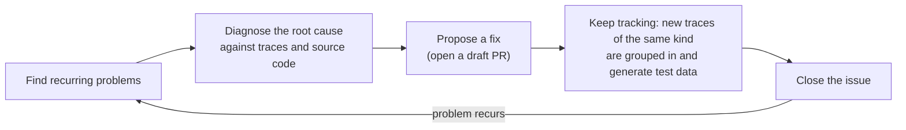
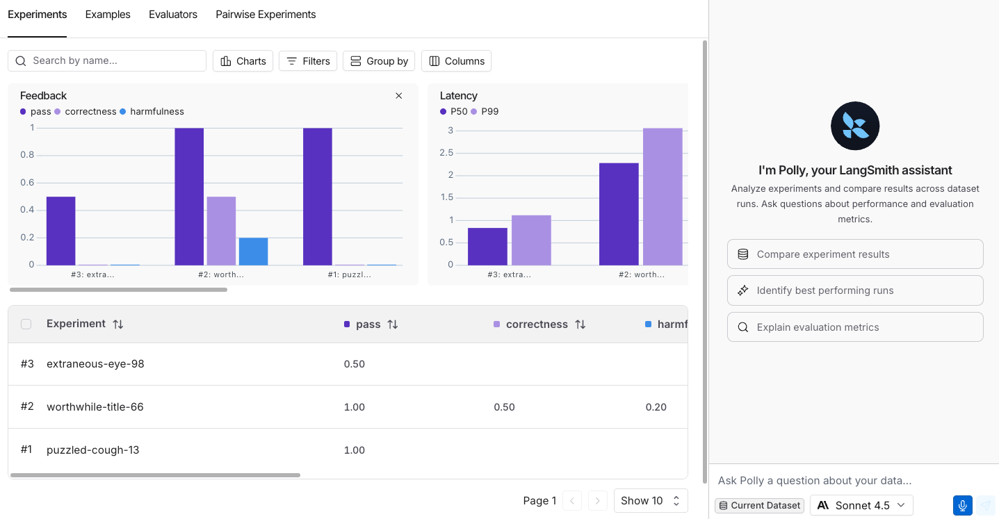
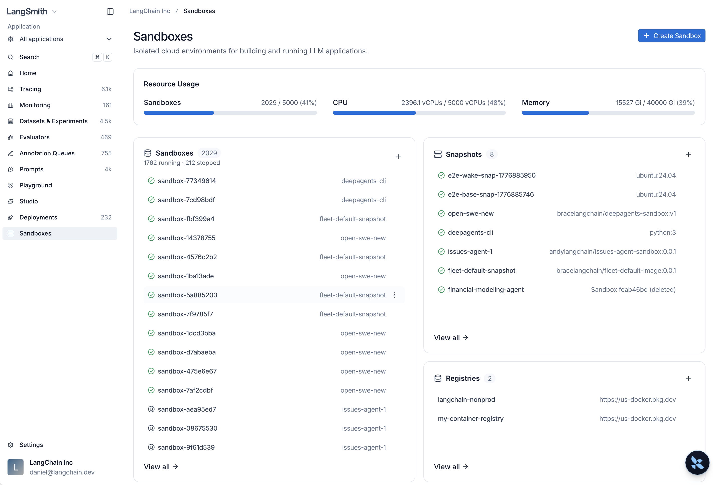

# 08 Engine, Chat, Sandboxes, LLM Gateway (Overview)

> Sources: [Engine](https://docs.langchain.com/langsmith/engine) · [LangSmith Chat](https://docs.langchain.com/langsmith/chat) · [Sandboxes](https://docs.langchain.com/langsmith/sandboxes) · [LLM Gateway](https://docs.langchain.com/langsmith/llm-gateway) · Verified 2026-10-28

These four are all relatively new features:

| Feature | In one sentence | Status |
|---------|-----------------|--------|
| **Engine** | Automatically finds recurring problems in production traces, diagnoses root causes, and opens PRs to fix them | Billed per LSU; some sub-features are Beta |
| **LangSmith Chat** | Built-in AI assistant (formerly Polly); ask questions directly on any page | Requires a configured model key |
| **Sandboxes** | Let agents execute code and manipulate files in an isolated environment | GA in all cloud regions |
| **LLM Gateway** | One LangSmith key to call all models, with unified tracing and governance | Beta |

---

## 1. Engine: Automatic Troubleshooting

### What it does



Engine periodically scans your tracing project (or agent environment), clusters problems, and ranks them by severity. Each issue includes related traces, a root-cause diagnosis, a suggested fix, and **test data** generated from production inputs (which can go straight into [offline evaluation in 04](04_evaluation.md) to verify that the fix really works).

### Details worth knowing

- **It prioritizes traces with poor feedback**: low scores from online evaluators, annotation queue ratings, and user feedback are all treated as high-priority signals. So set up [05](05_online_eval_feedback.md) first and Engine will be more accurate.
- **It learns from your actions**: when you close an issue, mark it **Incorrectly Flagged**, adjust priority, or open a PR, those actions are summarized into rules and written into the **User Preferences** of the agent overview, and later scans consult those rules.
- **Connect GitHub (optional but recommended)**: when Engine can read your source code, its diagnoses and fixes fit your actual implementation. It can only **read the repositories you select** and **open draft PRs**, and it **never merges on its own**. Currently, code changes can be proposed for agents written with Deep Agents, LangChain, and LangGraph.
- **Notifications**: issues can be pushed to Slack, Jira, or an alerting platform.
- **Beta features (Cloud only)**: **Fix validation** replays traces related to an issue to confirm the problem can be reproduced and no longer appears after the fix; **Red Teaming** proactively probes the agent with synthetic requests before launch.

### Cost

- Billed in **LSU (LangChain Standard Unit)**, where **1 LSU = $1**. Consumption depends on the number of traces analyzed, the model calls used for diagnosis, and the size of the connected code repositories.
- **Analysis levels**: Reduced (cheaper) / Standard (default) / Expanded (available only for high-traffic projects). The estimated monthly cost is shown during setup.
- **Spending cap**: the organization-level default is **750 LSU / month** (applies when the admin hasn't set one); you can also set a cap per project. New scans pause once the cap is reached.

### Enable it

Open the **Engine** tab in a tracing project or agent environment and follow [Set up Engine](https://docs.langchain.com/langsmith/engine-setup).

---

## 2. LangSmith Chat (formerly Polly)

An AI assistant built into the workspace. **Press `Ctrl+I` (`Cmd+I` on Mac) to open it**, and it answers questions based on the page you're currently on.


*Figure: the Chat sidebar (source: LangSmith Chat)*

| Page you're on | What you can ask |
|----------------|------------------|
| A project's run list | "Which runs failed in the past 24 hours?" "Add the failed runs to a test set" |
| A single trace | "Why did this fail?" "Which step was slowest?" "Where could the agent do better?" |
| Threads | "Is the user getting impatient?" "Was the user's problem resolved?" |
| Engine | "Why was this issue flagged?" "Explain the proposed fix" "Which one is most urgent?" |
| Playground | "Answer in Italian instead" "Make the tone more formal", or use Optimize prompt, Generate a tool, Generate an output schema |
| Experiments / datasets | "Which experiment is best?" "What do the failing examples have in common?" |
| Annotation queues | "What went wrong in this run?" "What should I watch for when scoring?" |
| Evaluator editor | "Write an evaluator that checks for hallucination" |

**Before you start**: add a model key under **Settings → Integrations → Provider secrets**. Anthropic, OpenAI, Gemini, Bedrock, Groq, Mistral, xAI, DeepSeek, and Fireworks are supported; a custom model configured in the Playground can also be used once **Available in Chat** is turned on.

---

## 3. Sandboxes: Safely Executing Agent-Generated Code

When an agent needs to run code or read and write files, do it in an isolated sandbox so it doesn't affect your own machine or infrastructure.

```python
from langsmith.sandbox import SandboxClient

client = SandboxClient()  # uses LANGSMITH_API_KEY

with client.sandbox() as sb:
    result = sb.run("python3 -c 'print(2 + 2)'")
    print(result.stdout)  # "4\n"
```


*Figure: the Sandboxes page (source: Sandboxes)*

- **Availability**: GA on GCP US / EU / APAC, AWS US, and BYOC; self-hosted requires separate enablement.
- **Networking**: non-Enterprise organizations have **outbound access restricted** by default, limited to common package registries, code repositories, and model APIs; to open it up fully, file a ticket.
- **Snapshots**: build from a Docker image, or save a running sandbox and start new sandboxes from it later.
- **Service URLs**: expose services running in the sandbox for access.
- **Sandbox CLI**: create sandboxes, run commands, and open an interactive shell without writing code.
- **Connecting to agents**: Deep Agents can use `LangSmithSandbox` directly as the execution backend; LangChain / LangGraph also support third-party sandboxes such as E2B, Daytona, and Modal.

---

## 4. LLM Gateway (Beta)

Developers need only one **LangSmith API key** to call every model provider configured in the workspace. Every call automatically becomes a trace, and admins can centrally set **spending caps, rate limits, and data policies**.

```bash
curl https://gateway.smith.langchain.com/v1/chat/completions \
    -H "Authorization: Bearer $LANGSMITH_API_KEY" \
    -H "Content-Type: application/json" \
    -d '{"model":"anthropic/claude-sonnet-5-5","messages":[{"role":"user","content":"Hello!"}]}'
```

| Item | Notes |
|------|-------|
| Request formats | OpenAI Chat Completions (`/v1/chat/completions`), Anthropic Messages (`/v1/messages`), OpenAI Responses (`/v1/responses`). Any format can call any configured provider, and the gateway converts automatically |
| Model ID | `provider/model`, such as `openai/...`, `anthropic/...`, `azure/<deployment-name>`; use `custom/<name>` for custom endpoints |
| Who pays for model usage | Your own provider account (an admin stores the key in Provider Secrets and billing goes through your provider); or **Gateway Credits** (provided by LangChain, billed on your LangSmith invoice) |
| Prerequisite | An admin first completes [Administrator setup](https://docs.langchain.com/langsmith/llm-gateway-admin-setup) |

The curl above uses the US-region address; for BYOC and self-hosted, add `/gateway` before the path. Prompts in the Prompt Hub can also be configured to call models through the gateway.
