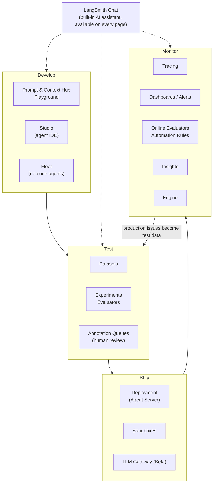
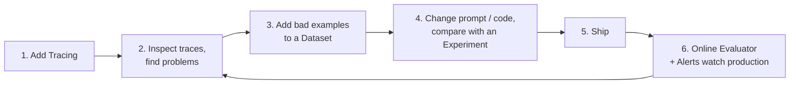
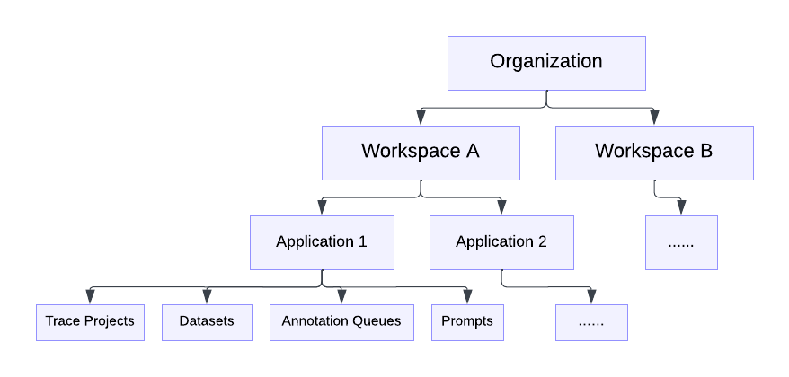

# LangSmith Overview and Getting-Started Tutorials

> **Last verified**: 2026-10-28 · **Source**: [LangSmith official docs](https://docs.langchain.com/langsmith) · **Screenshots**: taken from the official docs; copyright belongs to LangChain and they are used for internal learning only
>
> LangSmith changes quickly, and names and entry points may move. Where this guide disagrees with the UI you see, trust the official docs.

## What is LangSmith

[LangSmith](https://smith.langchain.com/) is LangChain's **agent engineering platform**. It covers the whole agent lifecycle, from development to production:

- **See everything**: record the input, output, latency, and cost of every step in every request (Tracing).
- **Measure it**: score your agent with datasets and evaluators, and compare versions (Evaluation).
- **Change it fast**: manage prompts and context outside your code so you can update them without redeploying (Prompt & Context Hub).
- **Run it reliably**: host your agent and automatically detect and diagnose problems in production (Deployment, Engine).

It is **framework-agnostic**. With LangChain / LangGraph, one environment variable turns on tracing. With the OpenAI SDK, Anthropic SDK, Claude Agent SDK, Pipecat, or your own code, there are matching wrappers and decorators.

## Product Map

## Recommended Development Loop

The value of this loop is that **every change is backed by data showing whether it made things better or worse**, instead of going by gut feeling.

## Feature List

| Area | What you can do | Status / plan requirement (as stated in the docs) | Tutorial |
|------|-----------------|---------------------------------------------------|----------|
| **Tracing** | Record the full execution tree of each request; group multi-turn conversations by thread; filter and search (including AI search, Beta), cost tracking, sampling, sensitive-data redaction, bulk export | — | [02](02_observability.md) |
| **Dashboards / Alerts** | Prebuilt dashboards generated automatically for each project; custom charts; alerts on latency, error rate, cost, and feedback scores (PagerDuty / webhook supported) | — | [03](03_monitoring.md) |
| **Insights** | Automatically cluster large numbers of traces to summarize what users are doing and which kinds of problems the agent fails on | Plus / Enterprise | [03](03_monitoring.md) |
| **Custom Apps** | Run your own UI inside LangSmith (for example, a dedicated annotation page) | Plus / Enterprise | [03](03_monitoring.md) |
| **Evaluation (offline)** | Dataset + target function + evaluators → Experiment; compare multiple experiments with regressions highlighted; Pairwise comparison | — | [04](04_evaluation.md) |
| **Online Evaluators** | Automatically score production traces: LLM-as-judge, code, multi-turn conversation, composite evaluators | — | [05](05_online_eval_feedback.md) |
| **Automation Rules** | Traces that match a condition are automatically added to a dataset or annotation queue, sent to a webhook, or given extended retention | — | [05](05_online_eval_feedback.md) |
| **Feedback / Annotation Queues** | Record user feedback from code; human review queues (single run, whole conversation, A/B pairwise) | — | [05](05_online_eval_feedback.md) |
| **Prompt & Context Hub** | Prompt versioning (commits + tags) that code pulls by name; Context Hub manages skills and agent instruction bundles, published per environment | — | [06](06_prompt_engineering.md) |
| **Playground** | Edit prompts, switch models, and run a whole dataset in the browser | — | [06](06_prompt_engineering.md) |
| **Deployment** | Hosted agent runtime (durable execution, streaming, horizontal scaling); supports LangGraph, Claude Agent SDK, CrewAI, Google ADK, and more | Cloud requires Plus or above | [07](07_deployment_fleet.md) |
| **Studio** | Visual IDE for agents: view the graph, step-by-step debugging, time travel, one-click deploy | Used with Agent Server | [07](07_deployment_fleet.md) |
| **Fleet** | No-code agent builder: start from templates, connect various apps, use it from Slack | Beta for self-hosted | [07](07_deployment_fleet.md) |
| **Engine** | Periodically scans production traces, finds recurring problems, diagnoses root causes, and opens fix PRs on GitHub | Billed per LSU | [08](08_engine_chat_sandbox.md) |
| **LangSmith Chat** | Built-in AI assistant (formerly Polly); ask questions directly on trace, conversation, experiment, and Playground pages | Requires a configured model API key | [08](08_engine_chat_sandbox.md) |
| **Sandboxes** | Safely execute agent-generated code and file operations in an isolated environment | GA in all cloud regions | [08](08_engine_chat_sandbox.md) |
| **LLM Gateway** | Call multiple model providers with one LangSmith key, with unified tracing, limits, and data policies | Beta | [08](08_engine_chat_sandbox.md) |
| **Remote MCP / CLI** | Let MCP clients such as Claude Code and Cursor read LangSmith data directly; query traces from the command line | All cloud regions | [02](02_observability.md) |

### Recent Renames (watch for these in older tutorials)

| Old name | New name |
|----------|----------|
| Polly | **LangSmith Chat** |
| Agent Builder | **LangSmith Fleet** (2026-03) |
| Prompt Hub | **Prompt & Context Hub** (Context Hub added) |
| `LANGCHAIN_API_KEY` / `LANGCHAIN_PROJECT` | `LANGSMITH_API_KEY` / `LANGSMITH_PROJECT` |

## Key Concepts

*Figure: Organization → Workspace → resources hierarchy (source: [Administration overview](https://docs.langchain.com/langsmith/administration-overview))*

| Concept | Meaning |
|---------|---------|
| **Organization / Workspace** | An organization contains multiple workspaces; API keys, datasets, and prompts belong to a workspace |
| **Agent + Environment** | New workspaces organize traces by "agent", and each agent has 4 fixed environments: `local`, `development`, `staging`, `production`. Alerts, dashboards, and Insights can be scoped to production only |
| **Tracing project** | The older way of organizing (also used by self-hosted): traces are grouped by project name |
| **Trace / Run** | One complete request is a trace; each step inside it (LLM call, tool call, retrieval) is a run, and runs can be nested |
| **Thread** | Multiple traces from the same conversation, linked by `thread_id` or `session_id` in metadata |
| **Dataset / Example** | A collection of test cases; each example has inputs and optional reference outputs |
| **Experiment** | The result of running one version of your application over an entire dataset and scoring it |
| **Feedback** | A score or comment attached to a run, from a user, an evaluator, or a human annotator |

> **How do I tell which kind of workspace I have?** Look at the switcher in the top-left corner: if it shows agents, the workspace is organized by agent; otherwise it is organized by project. The environment variables differ between the two; see [01 Quickstart](01_quickstart.md).

## Plans, Retention, and Limits (Summary)

| Item | Notes |
|------|-------|
| Free tier | The Developer plan includes 5,000 traces per month with no credit card |
| Data retention | Base traces are kept for **14 days**; extended retention is **180 days** (from 2026-09-14, the SaaS cap on long-term retention is 180 days across the board) |
| Automatic retention upgrade | Traces that run through an online evaluator, or are selected by an automation rule to extend retention, are automatically upgraded to extended retention, which **costs more** |
| Cloud regions | GCP US (default), GCP EU, GCP APAC, AWS US; non-US regions require setting `LANGSMITH_ENDPOINT` |
| Deployment models | Cloud (fully managed), BYOC (data stays in your VPC), Self-hosted (you run everything); the last two require Enterprise |

Prices change often; see [Pricing](https://www.langchain.com/pricing) and [Usage and billing](https://docs.langchain.com/langsmith/usage-and-billing) for current figures.

## Reading Order

| Order | Document | Type | Approx. time |
|-------|----------|------|--------------|
| 1 | [01 Quickstart: Your First Trace](01_quickstart.md) | Hands-on | 10 min |
| 2 | [02 Observability: Understanding and Using Traces](02_observability.md) | Hands-on | 30 min |
| 3 | [04 Evaluation: Evaluating Agents with Datasets](04_evaluation.md) | Hands-on | 30 min |
| 4 | [06 Prompt & Context Hub](06_prompt_engineering.md) | Hands-on | 20 min |
| 5 | [03 Monitoring: Dashboards, Alerts, Insights](03_monitoring.md) | How-to guide | 15 min |
| 6 | [05 Online Evaluation, Automation, and Human Annotation](05_online_eval_feedback.md) | How-to guide | 20 min |
| 7 | [07 Deployment, Studio, Fleet](07_deployment_fleet.md) | Overview | 10 min |
| 8 | [08 Engine, Chat, Sandboxes, Gateway](08_engine_chat_sandbox.md) | Overview | 10 min |

All code examples use **Python + Anthropic Claude**. If you use OpenAI, replace `wrap_anthropic` with `wrap_openai`; everything else is written the same way.
