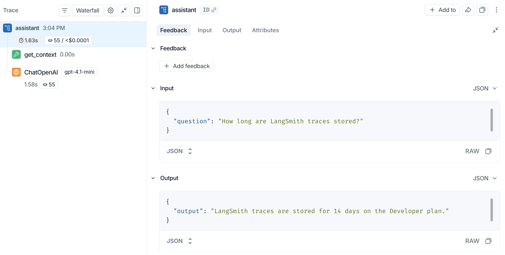

# 01 快速上手：10 分钟发出第一条 trace

> 来源：[Tracing quickstart](https://docs.langchain.com/langsmith/observability-quickstart) · [Create an API key](https://docs.langchain.com/langsmith/create-account-api-key) · [Log traces to an agent](https://docs.langchain.com/langsmith/log-traces-to-agent) · 核实日期 2026-10-28

**目标**：写一个会「先查资料、再问 Claude」的小助手，在 LangSmith 里看到它完整的执行过程。

## 准备

| 需要 | 怎么拿 |
|------|--------|
| LangSmith 账号 | 在 [smith.langchain.com](https://smith.langchain.com) 注册，支持 Google、GitHub 和邮箱登录 |
| LangSmith API key | **Settings → API Keys → Create API Key**。key 只显示一次，记得复制保存 |
| 模型 API key | 本教程用 Anthropic（[Claude Console](https://platform.claude.com/settings/keys)），OpenAI 和 Gemini 的写法也一样 |
| Python | 3.10 及以上 |

### 该用哪种 API key？

| 类型 | 权限 | 适合 |
|------|------|------|
| **Personal Access Token (PAT)** | 继承你本人的权限 | 本地脚本、学习、跑评估 |
| **Tracing key** | 只能上传 trace，读不到数据 | 线上服务（泄露了风险也小） |
| **Service key** | 限定在某些 workspace 或整个组织 | CI、后台任务 |

跟着本系列教程学习用 **PAT** 就行。线上服务只需要上传 trace，用 Tracing key 更安全。

## 第 1 步：装依赖

```bash
mkdir ls-quickstart && cd ls-quickstart
python -m venv .venv
# macOS / Linux
source .venv/bin/activate
# Windows PowerShell
# .venv\Scripts\Activate.ps1
pip install -U "langsmith>=0.14.9" anthropic
```

## 第 2 步：设环境变量

**先确认 workspace 类型**：看 LangSmith 网页左上角，显示 agent 的是按 agent 组织（新版 Cloud 默认），否则是按 project 组织（老工作区和自托管版）。

### 情况 A：按 agent 组织的工作区

1. 先在网页上点 **+ Agent → Observability**，填 **Agent name** 和 **Agent ID**（ID 创建后不能改，用英文短名，比如 `ls-quickstart`）。
2. 设环境变量：

```bash
# macOS / Linux
export LANGSMITH_TRACING=true
export LANGSMITH_API_KEY="<your-langsmith-api-key>"
export ANTHROPIC_API_KEY="<your-anthropic-api-key>"
export LANGSMITH_AGENT_ID="ls-quickstart"
export LANGSMITH_AGENT_ENVIRONMENT="local"   # local / development / staging / production
```

```powershell
# Windows PowerShell
$env:LANGSMITH_TRACING = "true"
$env:LANGSMITH_API_KEY = "<your-langsmith-api-key>"
$env:ANTHROPIC_API_KEY = "<your-anthropic-api-key>"
$env:LANGSMITH_AGENT_ID = "ls-quickstart"
$env:LANGSMITH_AGENT_ENVIRONMENT = "local"
```

> 这种工作区**不要**同时设置 `LANGSMITH_PROJECT`、`LANGCHAIN_PROJECT` 或 `LANGCHAIN_SESSION`，否则会和 agent 寻址冲突。

### 情况 B：按 project 组织的工作区（含自托管）

不用建 agent，直接用项目名（不存在会自动创建）：

```bash
export LANGSMITH_TRACING=true
export LANGSMITH_API_KEY="<your-langsmith-api-key>"
export ANTHROPIC_API_KEY="<your-anthropic-api-key>"
export LANGSMITH_PROJECT="ls-quickstart"
```

### 不在 US 区域？

账号在其他区域时，必须设置 `LANGSMITH_ENDPOINT`，否则 key 会认证失败：

| 区域 | `LANGSMITH_ENDPOINT` |
|------|----------------------|
| GCP US（默认） | `https://api.smith.langchain.com` |
| GCP EU | `https://eu.api.smith.langchain.com` |
| GCP APAC | `https://apac.api.smith.langchain.com` |
| AWS US | `https://aws.api.smith.langchain.com` |

如果你的 key 能访问多个 workspace，再加上 `LANGSMITH_WORKSPACE_ID` 指定用哪一个。

## 第 3 步：写代码

新建 `app.py`：

```python
from anthropic import Anthropic
from langsmith import traceable
from langsmith.wrappers import wrap_anthropic

client = wrap_anthropic(Anthropic())  # every Anthropic call is traced automatically


@traceable(run_type="tool")  # show this step as a tool span
def get_context(question: str) -> str:
    # In a real app, this would query a knowledge base or vector store
    return "LangSmith traces are stored for 14 days on the Developer plan."


@traceable  # the whole pipeline becomes one trace
def assistant(question: str) -> str:
    context = get_context(question)
    response = client.messages.create(
        model="claude-sonnet-5-5",
        max_tokens=1024,
        system=f"Answer using the context below.\n\nContext: {context}",
        messages=[{"role": "user", "content": question}],
    )
    return "".join(block.text for block in response.content if block.type == "text")


if __name__ == "__main__":
    print(assistant("How long are LangSmith traces stored?"))
```

这里用了两个工具：

- **`wrap_anthropic(...)`**：包一层 Anthropic 客户端，每次模型调用的 prompt、回复、token 数和花费都会被记录。
- **`@traceable`**：装饰任意函数，记录它的输入输出。被装饰的函数互相调用时，会自动形成父子嵌套。

## 第 4 步：运行并查看

```bash
python app.py
```

打开 LangSmith：

- **情况 A**：选中你的 agent → **Tracing** → 选环境（`local`）。
- **情况 B**：打开 **Tracing** → 项目 `ls-quickstart`。

点 `assistant` 这一行，打开 trace：


*图：左边是执行树，右边是选中那一步的输入输出（来源：官方 Tracing quickstart，截图里用的是 OpenAI，换成 Claude 后显示为 ChatAnthropic）*

能看到的内容：

- **左侧执行树**：`assistant`（总耗时 1.63s，55 tokens）→ `get_context`（工具）→ 模型调用。
- **右侧详情**：每一步的 Input、Output、Feedback，以及 Attributes（metadata、tag 等）。
- **Trajectory 标签页**：按对话的形式展示真正发给模型的消息。

## 用 LangChain / LangGraph？更简单

只要设好第 2 步的环境变量（`LANGSMITH_TRACING=true` + key + 目标），**不用改任何代码**，LangChain 和 LangGraph 会自动上报 trace。

## 常见坑

| 现象 | 原因 / 解决 |
|------|-------------|
| 网页上看不到 trace | 检查 `LANGSMITH_TRACING=true` 是否在**运行代码的那个终端**里设了；PowerShell 和 bash 的写法不一样 |
| 401 / 认证失败 | 账号不在 US 区域但没设 `LANGSMITH_ENDPOINT`；或者 key 属于另一个 workspace |
| trace 跑到了别的地方 | agent 工作区里还残留着 `LANGSMITH_PROJECT` 之类的旧变量，删掉 |
| 短命进程（脚本、Lambda）丢 trace | trace 是后台批量上传的。进程退出前，对**追踪实际用的那个 client** 调用 `flush()`：没传 client 时用的是全局默认 client，写 `from langsmith.run_trees import get_cached_client; get_cached_client().flush()`；注意新建一个 `Client()` 再 flush 是没用的 |
| 不想记录某些敏感字段 | 见 [02 Observability](02_observability.md) 的「脱敏」一节 |

## 下一步

- 想看懂 trace 的各种视图、把多轮对话串起来：[02 Observability](02_observability.md)
- 想给 agent 打分：[04 Evaluation](04_evaluation.md)
