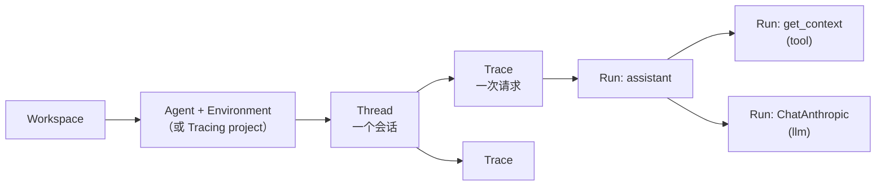
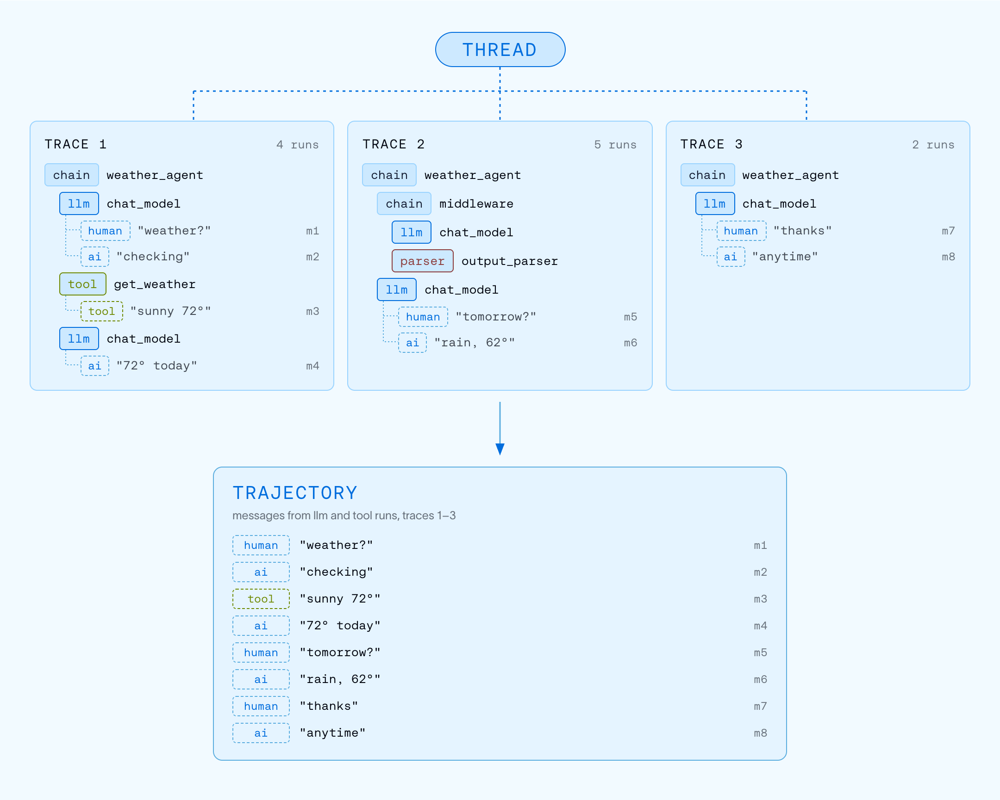
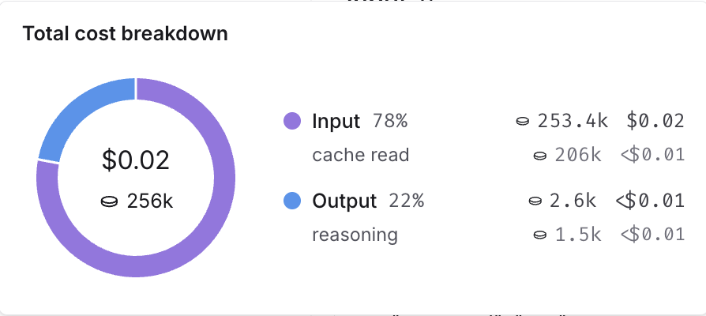
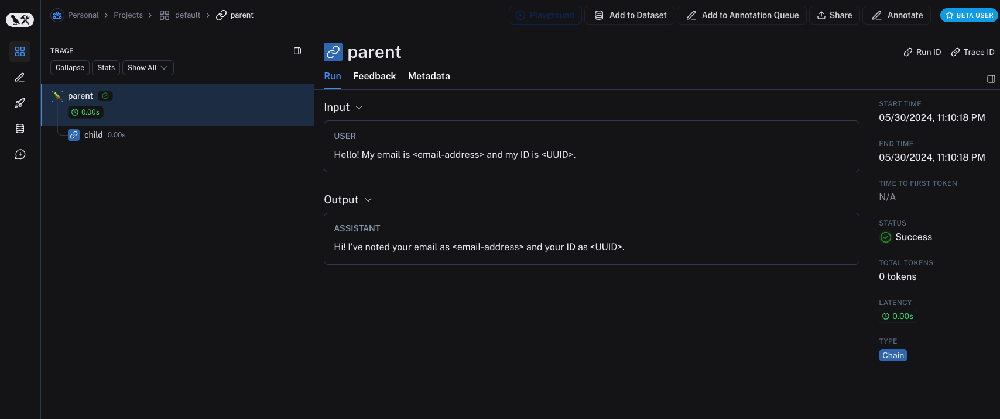

# 02 Observability：看懂和用好 trace

> 来源：[Observability concepts](https://docs.langchain.com/langsmith/observability-concepts) · [View traces](https://docs.langchain.com/langsmith/view-traces) · [Filter traces](https://docs.langchain.com/langsmith/filter-traces) · [Configure threads](https://docs.langchain.com/langsmith/threads) · [Cost tracking](https://docs.langchain.com/langsmith/cost-tracking) · [Sampling](https://docs.langchain.com/langsmith/sample-traces) · [Mask inputs/outputs](https://docs.langchain.com/langsmith/mask-inputs-outputs) · 核实日期 2026-10-28

前提：已经跑通 [01 快速上手](01_quickstart.md)。

## 1. trace 的结构



- **Run** 是最小单位：一次函数调用、一次模型调用、一次检索。用 `run_type` 区分，常见的有 `chain`（默认）、`llm`、`tool`、`retriever`、`prompt`、`parser`、`embedding`。
- **Trace** 是一次请求的完整执行树，根节点叫 root run。
- **Thread** 把同一个会话的多次请求串起来（要自己打标记，见第 3 节）。

## 2. 三种查看方式

打开一个 trace 或 thread，顶部有三个标签页：

| 视图 | 用途 |
|------|------|
| **Trajectory** | 按对话形式展示：每一轮里模型说了什么、调了哪些工具、工具返回了什么，以及 token 数和花费。适合**快速扫一遍**，找出异常的工具结果、奇怪的子 agent 交接、延迟突增 |
| **Turns** | 每一轮一张卡片，只显示根节点的输入输出，适合**看结构** |
| **Details** | 调试用：完整的执行树，每个 run 的输入、输出、metadata、耗时、报错。点进某个 run 时，所在会话的上下文仍然可见 |


*图：Thread 和 Trajectory 的关系（来源：Observability concepts）*

> 在 trace 页面按 `Ctrl+I`（Mac 上 `Cmd+I`）打开 **LangSmith Chat**，可以直接问「为什么这次失败了？」「哪一步最慢？」。详见 [08](08_engine_chat_sandbox.md)。

## 3. 动手：加 metadata、tag，并把多轮对话串成 thread

在 01 的代码基础上改一下。新建 `chat_app.py`：

```python
import uuid

from anthropic import Anthropic
from langsmith import traceable, tracing_context
from langsmith.wrappers import wrap_anthropic

client = wrap_anthropic(Anthropic())


@traceable(name="chat_turn", tags=["tutorial"])
def chat_turn(history: list[dict], user_message: str) -> str:
    messages = history + [{"role": "user", "content": user_message}]
    response = client.messages.create(
        model="claude-sonnet-5-5",
        max_tokens=512,
        messages=messages,
    )
    return "".join(block.text for block in response.content if block.type == "text")


def run_conversation() -> None:
    thread_id = str(uuid.uuid4())  # the docs recommend UUID v7 if available
    history: list[dict] = []
    for question in ["Hi, my name is Alex.", "What is my name?"]:
        # tracing_context applies the metadata to every run in this block,
        # including child runs; threads need thread_id on all of them
        with tracing_context(metadata={"thread_id": thread_id, "user_tier": "free"}):
            answer = chat_turn(history, question)
        history += [
            {"role": "user", "content": question},
            {"role": "assistant", "content": answer},
        ]
        print(f"> {question}\n{answer}\n")


if __name__ == "__main__":
    run_conversation()
```

运行后去网页上的 **Threads** 标签页，会看到一个包含两轮对话的 thread。

要点：

- thread 的标记 key 只能是 **`thread_id`** 或 **`session_id`**，值可以是任意字符串。
- 这个 metadata 要加在**所有 run 上**（包括子 run），否则过滤和 token 统计会不准。用 `tracing_context` 包住整段调用，最省事。
- metadata 和 tag **不会**自动在父子 run 之间传递。如果你想在看板上同时按 metadata 分组 trace 和 LLM 调用，两边都要有。
- 也可以只给某一次调用加 metadata：`chat_turn(history, q, langsmith_extra={"metadata": {...}})`。

## 4. 过滤和搜索

trace 列表上方的搜索栏支持查询语法，常用写法：

| 想找 | 查询 | 选择范围 |
|------|------|----------|
| 又慢又报错的 LLM 调用 | `run_type:llm AND status:error AND latency:>10` | Runs |
| 评估器打低分的 | `run_type:llm AND feedback.correctness.score:<0.5` | Runs |
| 生产环境失败的请求 | `metadata.env:production AND -status:success` | Traces |
| 提到退款且出错的对话 | `input:~"refund" AND status:error` | Threads |
| 调用过某个工具的请求 | `run_type:tool AND name:search_documents` | Traces + **Any run** |
| 花费超过 0.5 美元的请求 | `total_cost:>0.5` | Traces |

语法速查：

| 写法 | 含义 |
|------|------|
| `field:value` / `-field:value` | 等于 / 不等于 |
| `field:~value` | 全文搜索（`input`、`output`、`metadata`、`error` 只支持这个） |
| `field:value*` | 通配符 |
| `field:*` / `-field:*` | 字段存在 / 不存在 |
| `field:>10`、`field:[10 TO 20]` | 比较和范围（数值、时间字段） |
| `metadata.user_tier:free` | 用点号访问 JSON 里的 key |
| `A OR B`、`A AND B` | 组合条件 |

其他技巧：

- **范围选择器**：条件可以只匹配根 run（`in root run`）、任意 run（`in any run`）或整个 thread（`in thread`）。
- **AI 搜索（Beta）**：用自然语言搜，比如「agent 没完成任务的请求」「用户看起来很不耐烦的对话」，这类条件查询语法表达不了。
- **Saved views**：保存常用过滤条件，项目里所有人都能用。
- **在单个 trace 里过滤**：打开一个大 trace 后再过滤，匹配的 run 会被高亮，其余结构保留。

## 5. 成本和 token

用了 `wrap_anthropic` / `wrap_openai` 之后，token 数和花费会自动计算，鼠标悬停就能看到明细：


*图：花费明细（来源：Cost tracking）*

内置价格表已经包含大部分 OpenAI、Anthropic、Gemini 模型。用的是自托管模型或者有协议价的话，在 workspace 设置的模型价格表（Settings → Models）里新增或覆盖价格，或者在代码里自己上报 token 数和花费，见 [Cost tracking](https://docs.langchain.com/langsmith/cost-tracking)。

## 6. 控制上报量：采样

流量大时不需要每条都记录：

```bash
export LANGSMITH_TRACING_SAMPLING_RATE=0.1   # keep 10% of traces
```

也可以给不同的 `Client` 设不同的采样率：`Client(tracing_sampling_rate=0.25)`。

## 7. 保护敏感数据

| 需求 | 做法 |
|------|------|
| 完全不上报输入 / 输出 | 环境变量 `LANGSMITH_HIDE_INPUTS=true`、`LANGSMITH_HIDE_OUTPUTS=true` |
| 不上报 metadata | `LANGSMITH_HIDE_METADATA=true` |
| 按函数自定义 | `Client(hide_inputs=lambda inputs: {...}, hide_outputs=...)` |
| 按正则替换（邮箱、电话、卡号） | `langsmith.anonymizer.create_anonymizer`，见下例 |
| 更强的 PII 识别 | 接 Microsoft Presidio 或 Amazon Comprehend，官方文档有示例 |

```python
from langsmith import Client, traceable
from langsmith.anonymizer import create_anonymizer

anonymizer = create_anonymizer([
    {"pattern": r"[a-zA-Z0-9._%+-]+@[a-zA-Z0-9.-]+\.[a-zA-Z]{2,}", "replace": "<email>"},
    {"pattern": r"\b\d{3}[-.\s]?\d{3}[-.\s]?\d{4}\b", "replace": "<phone>"},
])
client = Client(anonymizer=anonymizer)


@traceable(client=client)
def handle(text: str) -> str:
    return f"received: {text}"


handle("Call me at 555-123-4567 or mail alex@example.com")
```


*图：隐藏输入输出后的效果（来源：Prevent logging of sensitive data）*

## 8. 集成清单

| 类别 | 支持（部分） |
|------|-------------|
| 框架 | LangChain、LangGraph（只设环境变量即可）；Deep Agents、CrewAI、Vercel AI SDK |
| 模型 SDK | OpenAI、Anthropic、Gemini（`wrap_*` 包装器） |
| Agent SDK | Claude Agent SDK、OpenAI Agents SDK |
| **语音** | **Pipecat**（Beta，需要 `langsmith[pipecat]`）、LiveKit、OpenAI Realtime；见 [Voice tracing fundamentals](https://docs.langchain.com/langsmith/trace-voice-fundamentals) |
| Coding agent | Claude Code、OpenAI Codex、Cursor 的会话也能追踪 |
| 通用 | OpenTelemetry；REST API；`@traceable` 包任何函数 |

完整列表：[Integrations](https://docs.langchain.com/langsmith/integrations)。

## 9. 数据导出和外部访问

- **批量导出**：按项目和日期范围把 trace 导出到 S3 兼容存储（Parquet 格式），也有导出到 BigQuery 的指南，见 [Bulk export](https://docs.langchain.com/langsmith/data-export)。
- **Remote MCP**：LangSmith 托管的 MCP 服务器，Claude Code、Cursor 等客户端用 OAuth 或 API key 连接后，可以直接查 run、prompt、对话历史，见 [Remote MCP](https://docs.langchain.com/langsmith/langsmith-remote-mcp)。
- **LangSmith CLI**：在终端里查看 trace，见 [LangSmith CLI](https://docs.langchain.com/langsmith/langsmith-cli)。

## 下一步

- trace 多了之后，用看板和告警盯整体状况：[03 监控](03_monitoring.md)
- 把看到的坏例子变成测试集：[04 Evaluation](04_evaluation.md)
