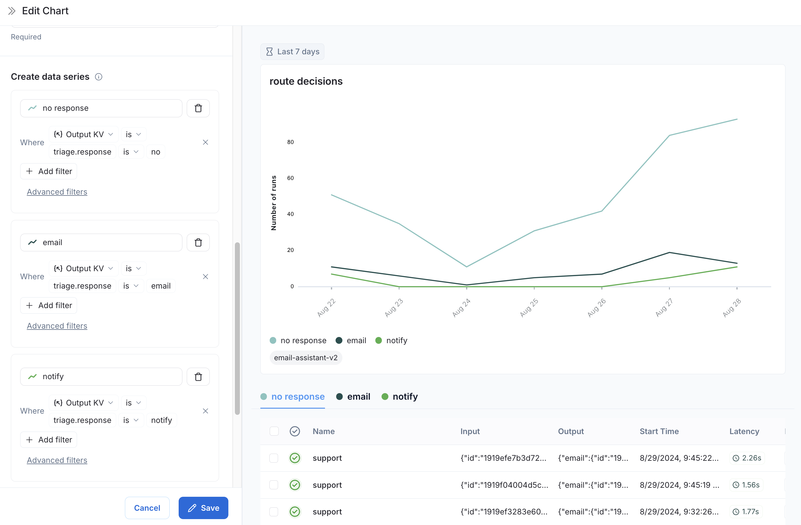
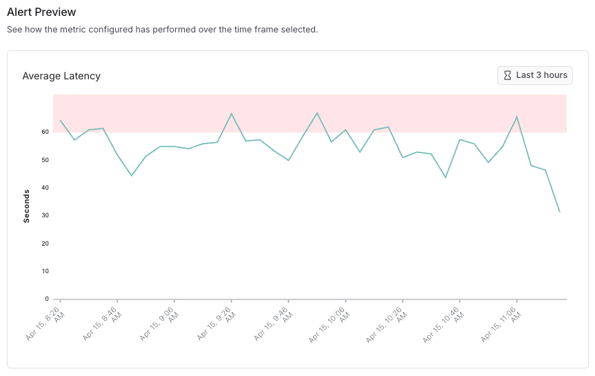
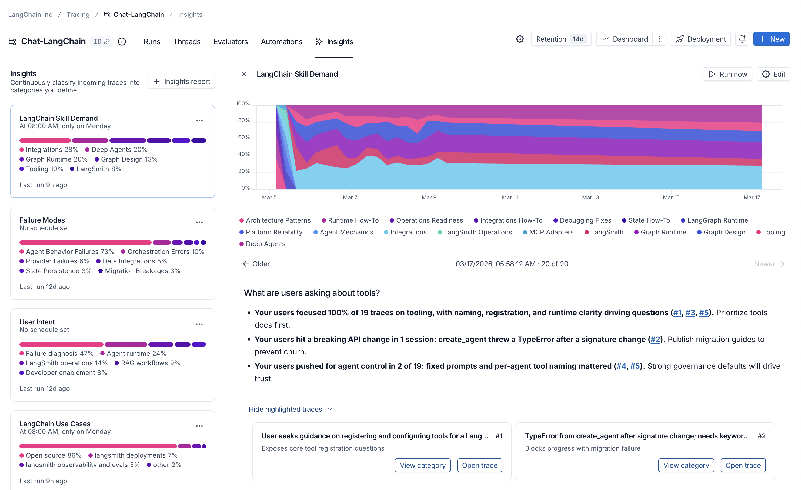

# 03 监控：Dashboards、Alerts、Insights、Custom Apps

> 来源：[Dashboards](https://docs.langchain.com/langsmith/dashboards) · [Alerts](https://docs.langchain.com/langsmith/alerts) · [Insights](https://docs.langchain.com/langsmith/insights) · [Custom Apps](https://docs.langchain.com/langsmith/custom-apps) · 核实日期 2026-10-28

单条 trace 用来调试，这一篇讲怎么**看整体**：趋势、异常、用户都在干什么。

| 工具 | 回答的问题 | 套餐 |
|------|-----------|------|
| Dashboards | 最近错误率、延迟、花费是什么走势？ | — |
| Alerts | 出问题时能不能第一时间知道？ | — |
| Insights | 用户都在问什么？agent 在哪类问题上失败？ | Plus / Enterprise |
| Custom Apps | 内置界面不够用，能不能自己做一个？ | Plus / Enterprise |

## 1. Dashboards

### 预置看板（自动生成）

每个 tracing project（或 agent 的每个环境）都有一个预置看板，在项目页点 **Dashboard** 按钮，或者在左侧 **Monitoring** 里打开：

| 区块 | 内容 |
|------|------|
| Traces | trace 数量、延迟、错误率 |
| LLM Calls | 模型调用次数和延迟 |
| Cost & Tokens | 总 token / 总花费，以及每条 trace 的平均值，按 token 类型拆分 |
| Tools | 最常用的 5 个工具的调用次数、错误率、延迟 |
| Run Types | 根节点下第一层 run 的统计，用来看 agent 主要走了哪些路径 |
| Feedback Scores | 最常见的 5 种反馈分数的汇总 |

右上角的 **Group by** 可以按 tag 或 metadata 拆分，比如按 `user_tier`、`model`、`prompt_version` 对比。

### 自定义看板

**Monitoring → + New Dashboard → + New Chart**。可以从模板开始，比如错误率走势、按模型的平均延迟、调用量、token 用量走势、最贵的模型；也可以自己定义数据系列和过滤条件：


*图：一个按路由结果拆分的自定义图表（来源：Dashboards）*

> 注意：新版自定义看板在 Cloud US 可用；EU / APAC 区域用的是旧版（legacy），界面略有不同。

## 2. Alerts

### 能告警的指标

| 指标 | 例子 |
|------|------|
| **Errors** | 5 分钟内超过 5% 的 run 报错（错误数或错误率都可以） |
| **Latency** | 平均延迟突然变高 |
| **Cost** | 花费超过预期（需要开启成本统计） |
| **Feedback Score** | 用户反馈或 online evaluator 的平均分下降 |
| **Run Count** | 调用量异常（比如突然没流量了，说明上游挂了） |

### 设置步骤

1. 打开要监控的 tracing project（agent 工作区里打开 agent 的某个环境，比如 production）。
2. 新建告警，选指标类型。Errors 和 Latency 还可以叠加过滤条件，比如只看某个工具、某个 tag。
3. 设置条件：
   - **聚合方式**：平均值、百分比或计数
   - **比较**：`>=`、`<=`
   - **阈值**
   - **时间窗口**：5 分钟或 15 分钟
4. 先看**预览**：用历史数据模拟，红点就是会触发告警的时间点，用来调阈值，避免告警太吵。
5. 选通知渠道：**Slack**、**PagerDuty**、**Dynatrace**，或者任意 **Webhook**（官方提供了几种常见接收端的配置示例）。


*图：告警预览（来源：Alerts）*

> 告警是**按项目（或按环境）配置**的，要监控多个项目就要分别设置。agent 工作区的好处是告警只盯 production，本地调试产生的 trace 不会误触发。

## 3. Insights

Insights 自动分析大量 trace，把它们**分层归类**，告诉你用户主要在做什么、agent 常见的行为和失败模式，不用一条条翻。

### 用 UI 生成报告

1. 在 workspace 设置里先给 Insights 配一个模型（model configuration）。
2. **Tracing** → 选项目（或 agent 的某个环境）→ 右上角 **+New → New Insights Report**。
3. 起个名字，回答引导问题（比如「我想知道用户最常遇到什么问题」），点 **Run job**。
4. 报告在后台生成，**最多约 30 分钟**。


*图：Insights 报告（来源：Insights）*

### 分析 LangSmith 之外的数据

已有的聊天记录（比如从数据库导出的）也可以用 SDK 上传后生成报告：

```python
import os

from langsmith import Client

client = Client()

chat_histories = [
    [
        {"role": "user", "content": "I was charged twice for my order"},
        {"role": "assistant", "content": "Sorry about that, let me check the payment."},
    ],
    [
        {"role": "user", "content": "How do I change my delivery address?"},
        {"role": "assistant", "content": "You can edit it under Orders > Details."},
    ],
]

report = client.generate_insights(
    chat_histories=chat_histories,
    name="Support topics - October",
    instructions="What are the main topics and problems users ask about?",
    openai_api_key=os.environ["OPENAI_API_KEY"],  # optional if set as a workspace secret
)
```

SDK 会先把聊天记录作为 trace 上传到一个新项目，再在上面生成报告，最后返回报告链接。

### Insights 和 Engine 有什么区别？

| | Insights | Engine |
|---|----------|--------|
| 定位 | 分析工具 | 修问题的工具 |
| 产出 | 分类 + 每类的指标，看使用模式和变化 | 具体的 issue：诊断、相关 trace、修复建议（可以直接开 PR） |
| 适合 | 了解「大家怎么用」 | 找出「哪里坏了、该怎么改」 |

Engine 见 [08](08_engine_chat_sandbox.md)。

## 4. Custom Apps

内置界面不能满足某个流程时（比如专门的标注页面、按业务定制的实验对比页、只看自己团队数据的看板），可以做一个 **Custom App**：

- 它在 LangSmith 里运行，调用 LangSmith API，出现在左侧栏 **Custom Apps** 下，不用另外部署服务或做登录。
- 可以和 LangSmith Chat 对话让它帮你做，也可以用 LangSmith CLI 在本地开发。
- 运行在没有外网的沙箱里，API 请求带的是**当前查看者**的权限，每个人只能看到自己有权限的数据。

详见 [Custom Apps](https://docs.langchain.com/langsmith/custom-apps)。

## 下一步

- 让线上 trace 自动被打分、自动进标注队列：[05 线上评估、自动化与人工标注](05_online_eval_feedback.md)
