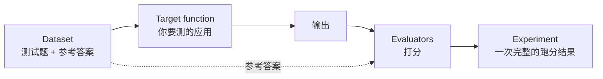
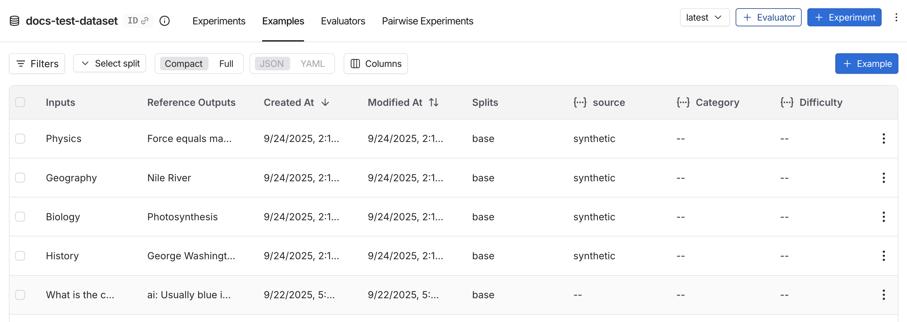
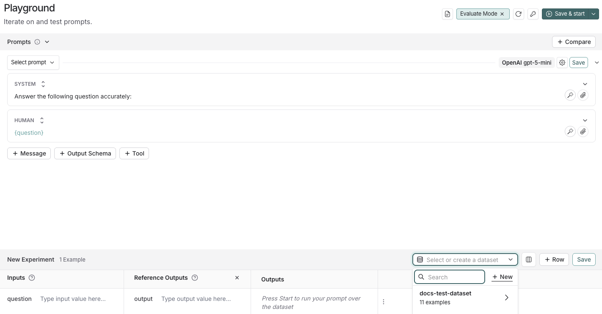
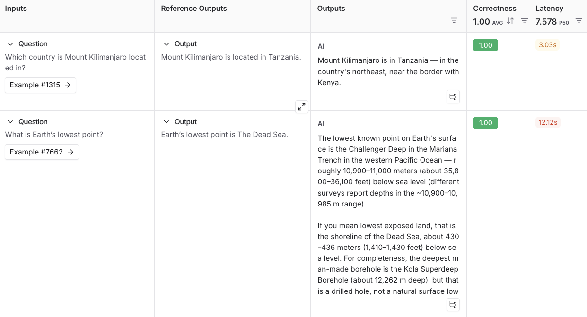
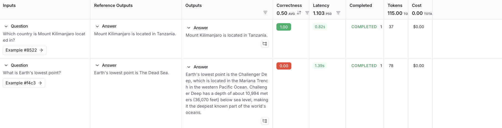
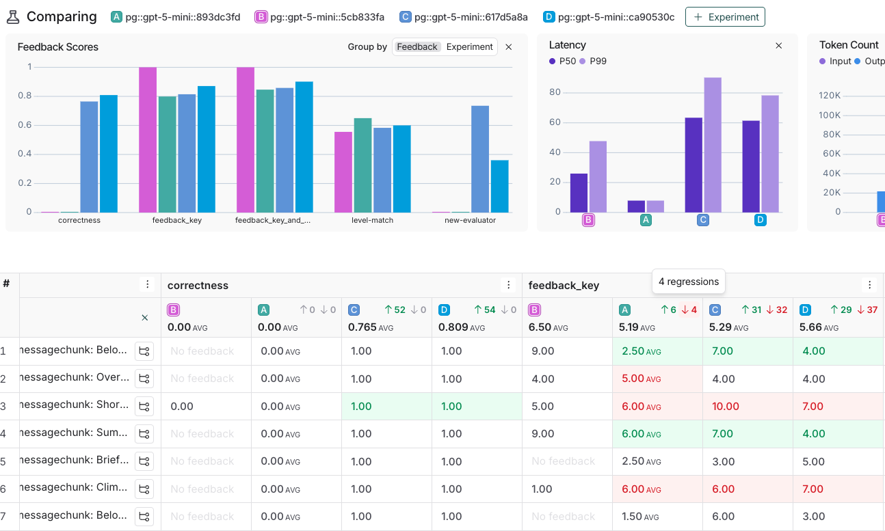
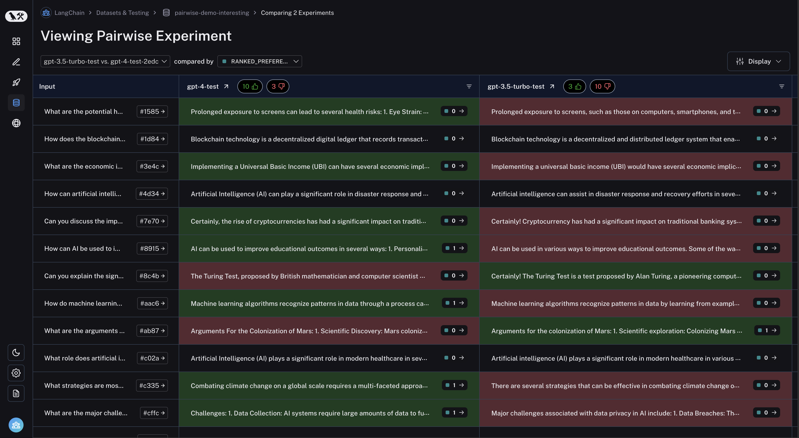
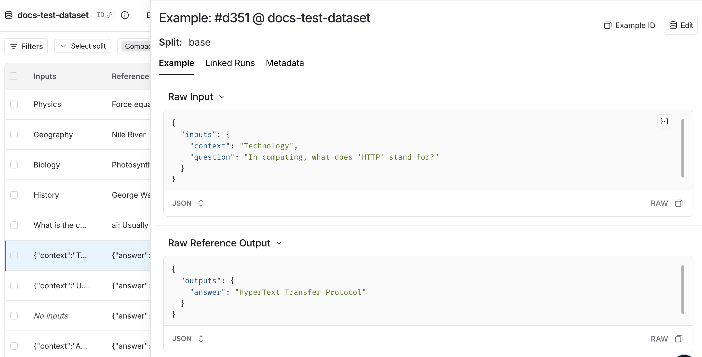

# 04 Evaluation：用数据集给 agent 打分

> 来源：[Evaluation quickstart](https://docs.langchain.com/langsmith/evaluation-quickstart) · [Evaluation concepts](https://docs.langchain.com/langsmith/evaluation-concepts) · [Compare experiment results](https://docs.langchain.com/langsmith/compare-experiment-results) · [Pairwise evaluation](https://docs.langchain.com/langsmith/evaluate-pairwise) · 核实日期 2026-10-28

LLM 的输出不稳定，改一个 prompt、换一个模型，效果可能变好也可能变差。评估的作用是**用同一批测试题、同一套评分标准**，把「感觉好像变好了」变成能比较的数字。

## 1. 三个要素



| 要素 | 说明 |
|------|------|
| **Dataset** | 一组 example，每条有 `inputs`，可选 `outputs`（参考答案） |
| **Target function** | 被测的东西：可以是一次模型调用、一个模块，也可以是整个 agent |
| **Evaluators** | 打分函数：代码规则、LLM-as-judge、人工标注、两两比较 |
| **Experiment** | 某个版本的 target 跑完整个 dataset 并打完分的结果，可以和其他 experiment 对比 |


*图：Datasets 页面（来源：Evaluation concepts）*

有两条路线：**A. 网页上点**（不写代码，适合测 prompt）；**B. 用 SDK**（适合测完整应用、接 CI）。

---

## 路线 A：在网页上评估一个 prompt

### A1. 配置模型 key

**Settings → Integrations → Provider secrets → + Secret**，选 Provider（比如 Anthropic），填入 key，保存。LangSmith 会用 `ANTHROPIC_API_KEY` 这样的名字保存。没有权限的话找 workspace 管理员。

### A2. 写 prompt

左侧栏 **Playground**，把 system prompt 改成：

```
Answer the following question accurately:
```

Human 消息保持 `{question}` 不变。

### A3. 建数据集

1. 点 **Set up Evaluation**，页面下方出现 **New Experiment** 表格。
2. 在 **Select or create a new dataset** 下拉框里点 **+ New**。


*图：在 Playground 里新建数据集（来源：Evaluation quickstart）*

3. 加两条 example：

| Inputs | Reference Outputs |
|--------|-------------------|
| question: Which country is Mount Kilimanjaro located in? | output: Mount Kilimanjaro is located in Tanzania. |
| question: What is Earth's lowest point? | output: Earth's lowest point is The Dead Sea. |

4. **Save**，给数据集起个名字。

### A4. 加评估器并运行

1. **+ Evaluator → Prebuilt Evaluator → Correctness → Save**。
2. 右上角 **Start**，生成一个 experiment。点实验名看完整结果：


*图：Experiment 完整视图（来源：Evaluation quickstart）*

---

## 路线 B：用 SDK 评估一个应用

### B1. 安装和环境变量

```bash
mkdir ls-eval && cd ls-eval
python -m venv .venv
source .venv/bin/activate        # Windows: .venv\Scripts\Activate.ps1
pip install -U langsmith anthropic openevals langchain-anthropic
```

环境变量和 [01](01_quickstart.md) 一样：`LANGSMITH_TRACING=true`、`LANGSMITH_API_KEY`、`ANTHROPIC_API_KEY`。key 能访问多个 workspace 时再加 `LANGSMITH_WORKSPACE_ID`。

> `openevals` 是 LangChain 开源的评估器库，内置了正确性、简洁性、幻觉等常用的评判 prompt。用 Claude 当评判模型需要 `langchain-anthropic`。

### B2. 建数据集：`dataset.py`

```python
from langsmith import Client

DATASET_NAME = "ls-tutorial-qa"

EXAMPLES = [
    {
        "inputs": {"question": "Which country is Mount Kilimanjaro located in?"},
        "outputs": {"answer": "Mount Kilimanjaro is located in Tanzania."},
    },
    {
        "inputs": {"question": "What is Earth's lowest point?"},
        "outputs": {"answer": "Earth's lowest point is the Dead Sea."},
    },
    {
        "inputs": {"question": "Who wrote 'Pride and Prejudice'?"},
        "outputs": {"answer": "Jane Austen wrote 'Pride and Prejudice'."},
    },
]


def main() -> None:
    client = Client()
    if client.has_dataset(dataset_name=DATASET_NAME):
        print("Dataset already exists:", DATASET_NAME)
        return
    dataset = client.create_dataset(
        dataset_name=DATASET_NAME,
        description="Tutorial QA dataset",
    )
    client.create_examples(dataset_id=dataset.id, examples=EXAMPLES)
    print("Created dataset:", dataset.name)


if __name__ == "__main__":
    main()
```

```bash
python dataset.py
```

### B3. 写 target 和评估器：`eval.py`

```python
from anthropic import Anthropic
from langsmith import Client
from langsmith.wrappers import wrap_anthropic
from openevals.llm import create_llm_as_judge
from openevals.prompts import CORRECTNESS_PROMPT

anthropic_client = wrap_anthropic(Anthropic())

SYSTEM_PROMPT = "Answer the following question accurately."


# Target: receives each example's inputs, returns a dict of outputs
def target(inputs: dict) -> dict:
    response = anthropic_client.messages.create(
        model="claude-sonnet-5-5",
        max_tokens=512,
        system=SYSTEM_PROMPT,
        messages=[{"role": "user", "content": inputs["question"]}],
    )
    text = "".join(block.text for block in response.content if block.type == "text")
    return {"answer": text.strip()}


# Code evaluator: cheap and deterministic
def concise(outputs: dict) -> bool:
    return len(outputs["answer"]) < 300


# LLM-as-judge evaluator from openevals
correctness_judge = create_llm_as_judge(
    prompt=CORRECTNESS_PROMPT,
    model="anthropic:claude-haiku-5-5",
    feedback_key="correctness",
)


def correctness(inputs: dict, outputs: dict, reference_outputs: dict):
    return correctness_judge(
        inputs=inputs,
        outputs=outputs,
        reference_outputs=reference_outputs,
    )


def main() -> None:
    client = Client()
    results = client.evaluate(
        target,
        data="ls-tutorial-qa",
        evaluators=[concise, correctness],
        experiment_prefix="sonnet-baseline",
        max_concurrency=2,
    )
    print(results)


if __name__ == "__main__":
    main()
```

评估器怎么写：

- 参数按名字注入，可以用 `inputs`、`outputs`、`reference_outputs`（还有 `run`、`example`），需要哪个写哪个。
- 返回 `bool`、数字，或者 `{"key": ..., "score": ...}` 这样的字典。
- 不指定 key 时，**函数名就是指标名**（上面的 `concise`）。

### B4. 运行并看结果

```bash
python eval.py
```

终端会打印一个链接，打开就是这次 experiment：


*图：Experiment 结果（来源：Evaluation quickstart）*

---

## 2. 对比实验：改动是变好了还是变坏了？

评估真正有用是在**对比**的时候。比如把 `eval.py` 里的 `SYSTEM_PROMPT` 改成 `"Answer in one short sentence."`，`experiment_prefix` 改成 `"sonnet-short"`，再跑一次。

然后在网页上：**Datasets → ls-tutorial-qa → Experiments**，勾选两个实验 → **Compare**。


*图：多个实验对比，回归标红、提升标绿（来源：Compare experiment results）*

对比视图里可以：

- **设基线**：选一个实验作为 source，其他实验和它比。
- **设方向**：每个指标可以设「越高越好」还是「越低越好」，红绿才会标对。
- **Diff 模式**：逐字对比两次输出的差异。
- **展开单条**：看某条 example 在各个实验里的完整 trace。
- **按 metadata 画图**：比如横轴选模型或 prompt 版本。

## 3. 评估器的类型

| 类型 | 适合 | 例子 |
|------|------|------|
| **代码 / 规则** | 有明确标准 | 长度、格式是否合法 JSON、是否调用了某个工具、和参考答案完全一致 |
| **LLM-as-judge** | 需要「理解」才能判断 | 正确性、有没有幻觉、语气是否合适 |
| **人工** | 标准难以自动化、需要校准评判模型 | 用 [Annotation Queues](05_online_eval_feedback.md#3-人工标注annotation-queues) |
| **Pairwise（两两比较）** | 绝对分数难打，但能比出哪个更好 | 两个版本的回复，让评判模型或人选 A / B |
| **Summary evaluator** | 指标要在整个数据集上算 | precision、recall、F1 |

### Pairwise 两两比较


*图：Pairwise 实验视图（来源：Pairwise evaluation）*

做法：先分别跑出两个实验，再把两个实验名作为一个 tuple 传给 `evaluate`，并提供比较型评估器。代码见 [Pairwise evaluation](https://docs.langchain.com/langsmith/evaluate-pairwise)。

## 4. 数据集从哪来

| 来源 | 怎么做 |
|------|--------|
| 手写 | 网页上直接加，或者像上面一样用 SDK |
| 线上 trace | 在 trace 页面点 **Add to → Dataset**；或者用[自动化规则](05_online_eval_feedback.md)把符合条件的 trace 自动加进来 |
| 文件 | 网页上传 CSV / JSONL |
| Engine | Engine 发现的 issue 可以一键生成测试数据，见 [08](08_engine_chat_sandbox.md) |

数据集会自动记版本，可以分 split（比如 `train`、`test`），也可以给 inputs / outputs 定义 schema。


*图：单条 example（来源：Evaluation concepts）*

## 常见坑

| 现象 | 原因 / 解决 |
|------|-------------|
| 评估器拿不到参考答案 | dataset 的 `outputs` 字段名要和评估器里取的 key 对上（本例都用 `answer`） |
| 跑得很慢或者被限流 | 调小 `max_concurrency`；LLM-as-judge 也会调模型，一起算进限流 |
| LLM-as-judge 分数不靠谱 | 先人工标一小批，对比评判模型的结果再调 prompt；可以在 openevals 里加 few-shot 例子 |
| 每次跑都重复建数据集 | 用 `client.has_dataset(...)` 先检查，像 `dataset.py` 那样 |
| 评估要计费吗 | 实验里的每次运行也会产生 trace；LLM-as-judge 另外消耗模型调用费用 |

## 下一步

- 把评估器挂到线上流量：[05 线上评估](05_online_eval_feedback.md)
- 把 prompt 交给 LangSmith 管理，改了直接测：[06 Prompt & Context Hub](06_prompt_engineering.md)
