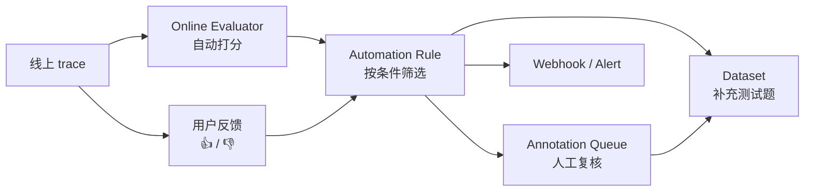
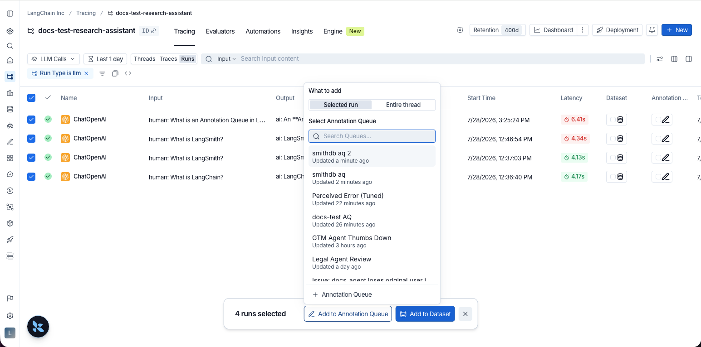
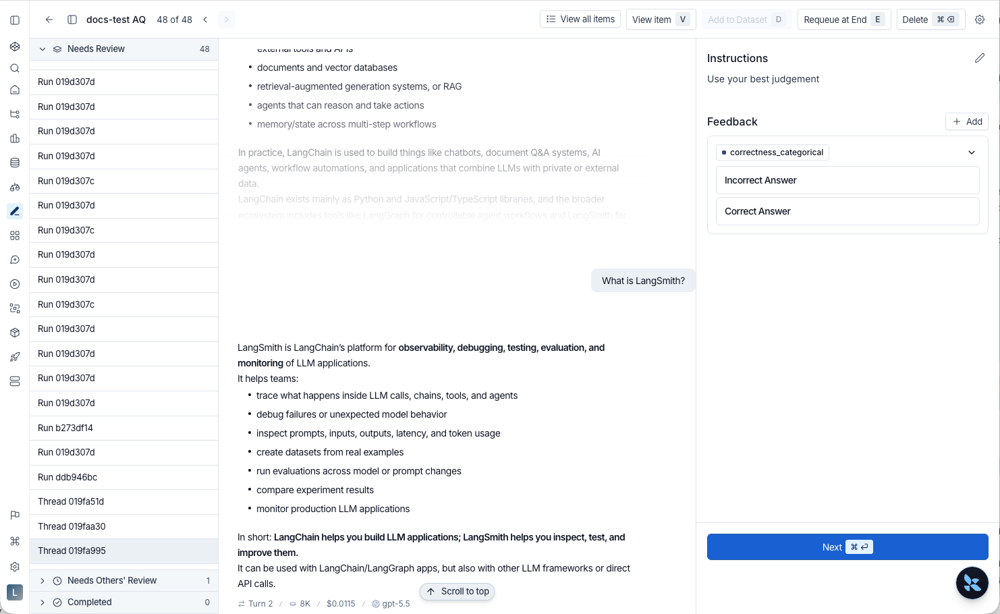
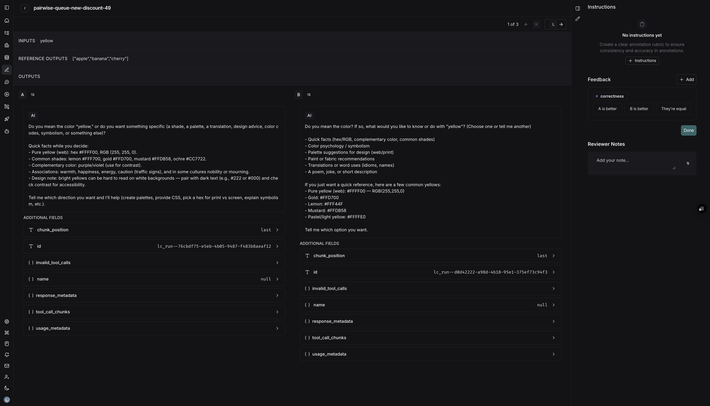

# 05 线上评估、自动化规则与人工标注

> 来源：[Online LLM-as-judge](https://docs.langchain.com/langsmith/online-evaluations-llm-as-judge) · [Online code evaluators](https://docs.langchain.com/langsmith/online-evaluations-code) · [Multi-turn](https://docs.langchain.com/langsmith/online-evaluations-multi-turn) · [Composite](https://docs.langchain.com/langsmith/online-evaluations-composite) · [Automation rules](https://docs.langchain.com/langsmith/rules) · [Annotation queues](https://docs.langchain.com/langsmith/annotation-queues) · [User feedback](https://docs.langchain.com/langsmith/attach-user-feedback) · 核实日期 2026-10-28

[04](04_evaluation.md) 讲的是**上线前**用固定数据集打分（离线评估）。这一篇讲**上线后**：



## 1. Online Evaluators：自动给线上 trace 打分

### 四种类型

| 类型 | 作用 | 典型用途 |
|------|------|----------|
| **LLM-as-judge** | 用模型给单个 run 打分 | 回答是否切题、有没有幻觉、语气 |
| **Code** | 用代码给单个 run 打分 | 输出是否是合法 JSON、长度、是否包含敏感词 |
| **Multi-turn** | 给**整段对话**（thread）打分 | 用户的问题最后解决了没有、用户是否不满 |
| **Composite** | 把多个评估器的分数按权重合成一个（加权平均或加权求和） | 「综合质量分」= 正确性 × 0.6 + 语气 × 0.4（加权平均） |

### 设置 LLM-as-judge 评估器

1. **Tracing** → 选项目（或 agent 的 production 环境）→ **Evaluators** 标签页。
2. **+ Evaluator**，三选一：
   - **Create from scratch** → LLM-as-a-Judge Evaluator
   - **Attach an existing evaluator**：复用 workspace 里已有的
   - **Create from a template**：从现成的模板开始
3. 起名，写评判 prompt，选评判模型（需要先在 Provider secrets 里配好 key）。
4. **加过滤条件**，只评估需要的 run。例如：
   - 用户给了差评的 run
   - 调用过某个工具的 run
   - metadata 匹配的 run（比如只评估 `plan_type=enterprise` 的客户）
   - 另一个评估器分数低于某个值的 run（链式评估）
5. **设采样率**：比如只评估 10%，控制成本。
6. （可选）**应用到历史 run**：对已有的 trace 补跑一遍。

> ⚠️ **成本提醒**：online evaluator 跑过的 trace 会**自动升级为扩展保留（180 天）**，单价更高；评判模型的调用也要花钱。先用低采样率试，确认有用再调高。可以在 [Evaluator spend](https://docs.langchain.com/langsmith/evaluator-spend) 设置花费上限。

### 多轮对话评估

Multi-turn 评估器作用在 **thread** 上，前提是 trace 带了 `thread_id` / `session_id` metadata（见 [02 第 3 节](02_observability.md#3-动手加-metadatatag并把多轮对话串成-thread)）。最后一条 trace 到达后，LangSmith 会等你设定的**空闲时间（idle time）**过去，认为对话已结束，再评估整段对话。所以每个 thread 只评估一次，而不是每条 trace 都评估。

## 2. Automation Rules：按条件自动处理 trace

规则 = **过滤条件** + **采样率** + **动作**。

| 动作 | 例子 |
|------|------|
| 加入 Annotation Queue | 所有差评的 trace 送人工复核；随机抽 10% 做抽检 |
| 加入 Dataset | 报错的 trace 自动进回归测试集 |
| 触发 Webhook | 评估器低分的 trace 推送到你的服务（比如做远程评估、发工单） |
| 运行 online evaluator / 代码评估器 | 见上一节 |
| 延长数据保留 | 报错的 trace 升级为扩展保留，方便以后排查 |
| 触发 Alert | 见 [03](03_monitoring.md) |

### 设置时要注意

- **Item Type** 选 **Runs** 还是 **Threads**：选 Runs 时每个 run 到达就处理；选 Threads 时等对话结束再处理（只能加入标注队列、加入数据集或触发 webhook）。
- **多条规则之间没有先后顺序保证**：每条规则独立轮询。如果 webhook 需要带上评估分数，不要指望「评估规则先跑」，而是在 webhook 规则里加一个反馈过滤条件，比如 `feedback.correctness.score` 存在才触发。
- 同一条规则里配了多个动作时，按固定顺序执行：标注队列 → 数据集 → webhook → online evaluator → 代码评估器 → 延长保留 → 告警。

## 3. 人工标注（Annotation Queues）

### 创建队列

1. 左侧 **Annotation Queues → + Annotation Queue**。
2. 填 **Name**、**Description**；可以选一个**默认数据集**，审核完一键存进去。
3. 写 **Instructions**（标注说明，每条都会显示在侧边栏）。
4. **+ Add a feedback rubric**：定义要打的分，比如 `correctness`（0/1）、`tone`（good / neutral / bad），并写清每一项的含义。

### 把内容加进队列

| 从哪加 | 怎么做 |
|--------|--------|
| 单条 run | trace 的 Details 视图里，run 标题栏 **Add to → Add to Annotation Queue** |
| 整段对话 | Details 视图里，在 Trajectory / Turns / Details 标签旁边点「加入队列」图标（需要 thread metadata） |
| 批量 | run 列表或 Threads 列表里多选，底部 **Add to Annotation Queue** |
| 实验结果 | 选中实验，底部 **Annotate** |
| 自动 | 用上一节的 Automation Rule |


*图：批量加入标注队列（来源：Annotation queues）*

### 审核

打开队列后逐条审核：中间显示对话或 run，右侧是标注说明和评分项。打分、写备注、标记已审核，或者 **Add to Dataset** 把它存成测试题。


*图：审核一段对话（来源：Annotation queues）*

### Pairwise 队列（A/B 对比）

选两个实验 → **Add to Pairwise Annotation Queue**。审核时两个版本的输出并排显示，选 **A / B / Equal**，支持键盘快捷键。适合「很难打绝对分，但能看出哪个更好」的场景。


*图：Pairwise 审核界面（来源：Annotation queues）*

## 4. 用代码记录用户反馈

在你的产品里加 👍 / 👎 按钮，把用户的评价记到 trace 上，之后就能按反馈过滤、告警、送人工复核。

```python
import asyncio

from langsmith import Client, trace, traceable

client = Client()


@traceable
def answer(question: str) -> str:
    return f"Here is how to handle: {question}"  # call your model here


question = "Reset my password"
with trace(name="support_request", inputs={"question": question}) as root_run:
    root_run.outputs = {"answer": answer(question)}

# Feedback needs the trace's session (project) ID
if root_run.address is not None:  # agent-based workspace
    session_id = asyncio.run(client.sessions.resolve(**root_run.address)).session_id
else:  # project-based workspace
    session_id = client.read_project(project_name=root_run.session_name).id

# Later, when the user clicks thumbs up in your UI
client.create_feedback(
    key="user_thumb",
    score=1,
    comment="The steps worked",
    trace_id=root_run.id,
    session_id=session_id,
)
```

要点：

- 真实的 Web 应用里，回复用户时把 `trace_id` 和 `session_id` 一起返回给前端，用户点按钮时再调 `create_feedback`。
- **一定要带 `trace_id`**：反馈可以在后台批量上传，不阻塞请求。
- **`session_id` 也要带**：SDK 文档说明，run 级别的反馈不带 `session_id` 的写法已被弃用。
- `score` 用数字或布尔值；`value` 可以放类别（比如 `"too_long"`）；`comment` 放文字说明。

## 下一步

- 把线上发现的问题交给 Engine 自动诊断：[08](08_engine_chat_sandbox.md)
- 把 prompt 交给 LangSmith 管理：[06 Prompt & Context Hub](06_prompt_engineering.md)
