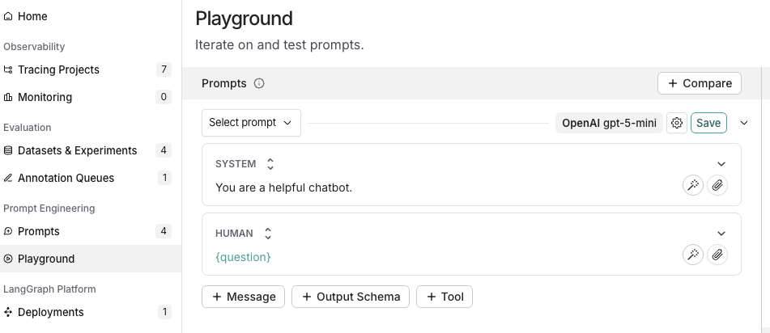
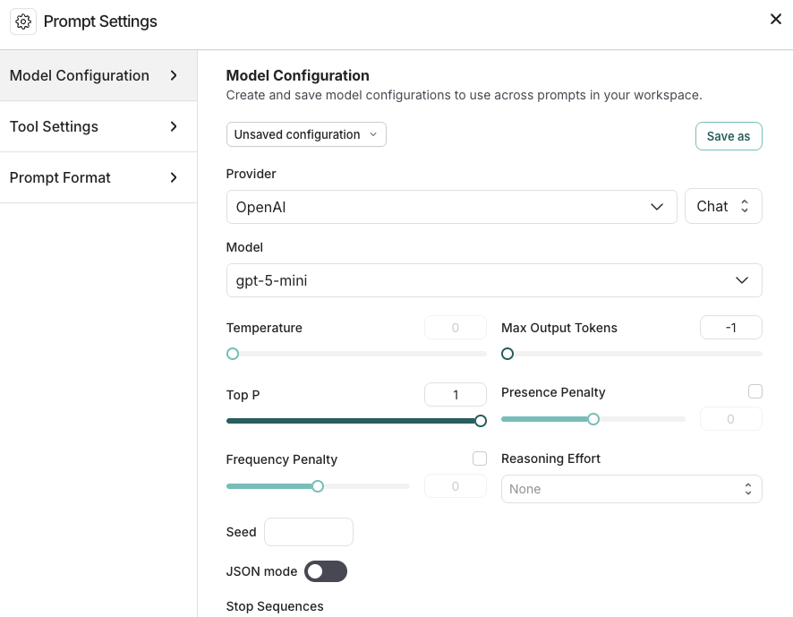
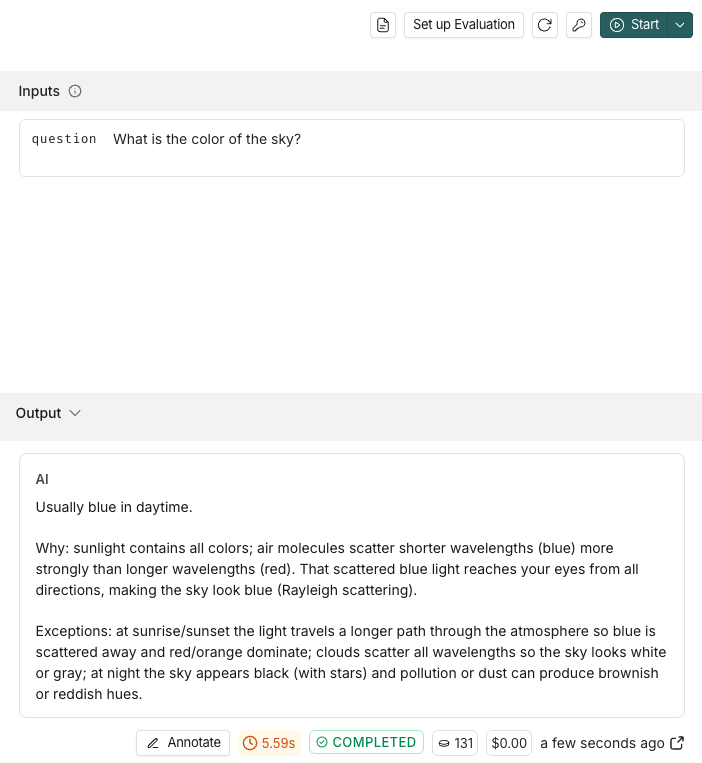
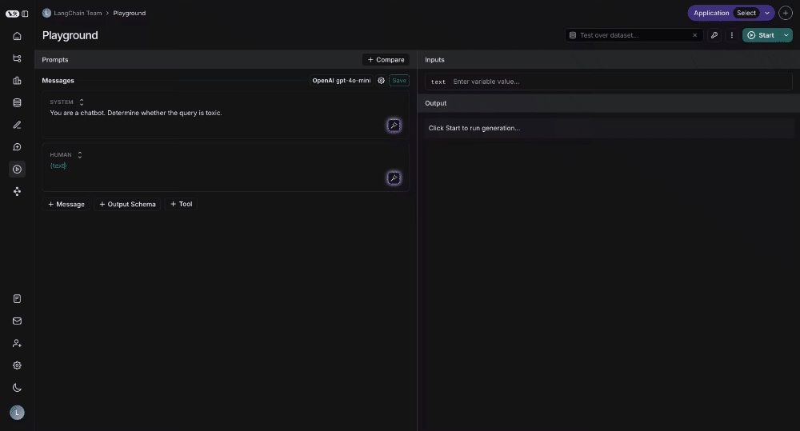

# 06 Prompt & Context Hub：把 prompt 从代码里拿出来管理

> 来源：[Prompt & Context Hub](https://docs.langchain.com/langsmith/prompt-context-hub) · [Prompt engineering quickstart](https://docs.langchain.com/langsmith/prompt-engineering-quickstart) · [Manage prompts](https://docs.langchain.com/langsmith/manage-prompts) · [Manage prompts programmatically](https://docs.langchain.com/langsmith/manage-prompts-programmatically) · [Context engineering concepts](https://docs.langchain.com/langsmith/context-engineering-concepts) · [Manage contexts with the SDK](https://docs.langchain.com/langsmith/manage-contexts-sdk) · 核实日期 2026-10-28

**为什么要这么做？** prompt、检索上下文、技能说明这些东西改得比代码勤，而且经常是产品、运营这些不写代码的人在改。放进 LangSmith 管理后：

- 每次修改都是一个 **commit**，能看 diff、能回滚。
- 通过 **Staging / Production** 两个环境发布，代码按环境拉取，**改 prompt 不用重新部署**。
- 改完直接在 Playground 里对数据集跑一遍，确认没有变差再发布。

Hub 分两部分：

| | Prompts | Context Hub |
|---|---------|-------------|
| 管理什么 | 单个消息模板（system + user …） | 一整套指令包：技能（skill）或完整 agent 的配置 |
| 典型内容 | `ChatPromptTemplate` | `AGENTS.md`、`SKILL.md`、`tools.json` 等文件 |
| SDK | `push_prompt` / `pull_prompt` | `push_agent` / `pull_agent`、`push_skill` / `pull_skill` |

---

## 1. 在网页上创建和测试 prompt

### 1.1 配置模型 key

**Settings → Integrations → Provider secrets → + Secret**，选 Provider，填 key。

### 1.2 新建 prompt

左侧 **Prompts → + Prompt**，编辑消息和变量（用 `{question}` 这样的花括号表示变量）。


*图：新建 prompt（来源：Prompt engineering quickstart）*

### 1.3 选模型、试运行

1. 点模型名旁边的齿轮，打开 **Model Configuration**：选 Provider、Model，调 temperature、max tokens、reasoning effort 等参数。


*图：模型配置（来源：Prompt engineering quickstart）*

2. 在 **Inputs** 里填变量的值，点 **Start**，右边显示输出。


*图：试运行（来源：Prompt engineering quickstart）*

3. 满意后点 **Save**（或 **Commit**）保存为一个新版本。

### 1.4 对整个数据集测试

单条试运行不够说明问题。在 Playground 里选一个数据集，一次跑完所有 example 并用评估器打分（和 [04 路线 A](04_evaluation.md#路线-a在网页上评估一个-prompt) 一样）：


*动图：对数据集测试（来源：Prompt engineering concepts）*

### 1.5 让 AI 帮你改 prompt

- **LangSmith Chat**（`Ctrl+I`）在 Playground 里可以：**Optimize prompt**、**Generate a tool**、**Generate an output schema**，或者直接说「改成用意大利语回答」「语气更正式一点」。
- **Prompt Canvas**：交互式的 prompt 编写工具，见 [Prompt Canvas](https://docs.langchain.com/langsmith/write-prompt-with-ai)。

### 1.6 发布：Staging / Production

在 prompt 详情页：

1. 左侧是 commit 历史，右上角 **Diff** 可以和上一版对比。
2. 把鼠标放在某个 commit 上，点 **Promote** → 选 **Staging** 或 **Production**，确认后立即生效。
3. 出问题时，在左侧对应环境旁点**回滚**图标，从历史里选之前的 commit。

除了这两个保留的环境，你也可以打自定义的 **commit tag**（比如 `v2-experiment`），之后可以把 tag 移到别的 commit 上。

---

## 2. 用 SDK 管理 prompt

### 2.1 安装

```bash
pip install -U langsmith anthropic langchain-core
```

环境变量：`LANGSMITH_API_KEY`、`ANTHROPIC_API_KEY`（不需要开 tracing 也能用 Hub）。

### 2.2 推送 prompt：`push_prompt.py`

```python
from langchain_core.prompts import ChatPromptTemplate
from langsmith import Client

client = Client()

prompt = ChatPromptTemplate([
    ("system", "You are a helpful support assistant for an online store. Be concise."),
    ("user", "{question}"),
])

# Creates the prompt on first push; later pushes add a new commit
url = client.push_prompt("ls-tutorial-support", object=prompt)
print(url)
```

再推一次（内容不同）就是第二个 commit。推送时也可以直接打 tag：`client.push_prompt(..., commit_tags=["v2-experiment"])`。

### 2.3 在应用里拉取并调用 Claude：`use_prompt.py`

```python
from anthropic import Anthropic
from langsmith import Client

client = Client()
anthropic_client = Anthropic()

# "name" = latest commit, "name:production" = the Production environment,
# "name:<commit-hash>" or "name:<tag>" = a pinned version
prompt = client.pull_prompt("ls-tutorial-support")

messages = prompt.invoke({"question": "How do I change my delivery address?"}).to_messages()

# Anthropic takes the system prompt separately from the conversation
system = "\n".join(m.content for m in messages if m.type == "system")
conversation = [
    {"role": "user" if m.type == "human" else "assistant", "content": m.content}
    for m in messages
    if m.type != "system"
]

response = anthropic_client.messages.create(
    model="claude-sonnet-5-5",
    max_tokens=512,
    system=system,
    messages=conversation,
)
print("".join(block.text for block in response.content if block.type == "text"))
```

线上代码建议拉 `ls-tutorial-support:production`：在网页上把新版本 Promote 到 Production，应用下次拉取时就会用上新版，不用发版。

### 2.4 缓存

SDK 会把拉到的 prompt 缓存在内存里，**默认 5 分钟**后视为过期并在后台刷新，所以 Promote 之后最多几分钟就会生效。

| 需求 | 写法 |
|------|------|
| 这一次强制拉最新 | `client.pull_prompt("name", skip_cache=True)` |
| 整个 client 不用缓存 | `Client(disable_prompt_cache=True)` |

### 2.5 其他用法

- **连同模型配置一起拉**：`client.pull_prompt("name", include_model=True)` 返回「prompt + 模型」组成的可直接调用的对象（需要安装对应的 `langchain-<provider>` 包）。
- **Webhook**：每次 prompt 有新 commit 时通知你的服务，比如触发 CI 跑一遍评估。
- **公开 Prompt Hub**：可以浏览和复用社区分享的 prompt。用代码拉取时写 `client.pull_prompt("owner/name", dangerously_pull_public_prompt=True)`。这个参数默认关闭，因为拉下来的 prompt 应当被看作**可执行的配置**，只对信得过的 prompt 打开。

---

## 3. Context Hub：管理技能和 agent 的上下文

当 agent 的「非代码部分」不止一个 prompt 时（系统指令、工具定义、参考资料、可复用的技能），用 Context Hub 统一管理。

| 概念 | 含义 | 常见文件 |
|------|------|----------|
| **Skill repo** | 一个可复用的能力，多个 agent 可以共用，比如「邮件格式规范」「代码审查」 | `SKILL.md` + 参考资料、模板、schema |
| **Agent repo** | 某个 agent 的完整配置 | `AGENTS.md`（系统指令）、`tools.json`，以及链接的 skill / 子 agent |
| **链接** | agent repo 可以引用 skill repo；被引用的 skill 更新后，会自动传播到引用它的 agent | — |

和 prompt 一样有版本，可以 Promote 到环境；也可以配置 commit webhook。

```python
from langsmith import Client
from langsmith.schemas import FileEntry

client = Client()

# Push a new version of an agent repo (created on first push)
url = client.push_agent(
    "ls-tutorial-email-assistant",
    files={
        "AGENTS.md": FileEntry(content="You are an email triage assistant."),
        "tools.json": FileEntry(content='{"tools": []}'),
    },
    description="Triages and drafts replies to incoming email.",
)
print(url)

# Pull it back: latest, or the version promoted to production
agent = client.pull_agent("ls-tutorial-email-assistant")
print(agent.commit_hash, list(agent.files))
prod = client.pull_agent("ls-tutorial-email-assistant:production")
```

> 小技巧：同一段上下文复制到了好几个 agent 里，就把它抽成一个 skill repo，再从各个 agent 引用。

## 常见坑

| 现象 | 原因 / 解决 |
|------|-------------|
| `pull_prompt` 报找不到 | 名字拼错，或者 API key 属于另一个 workspace；公开的 prompt 要用 `owner/name` 格式，并加 `dangerously_pull_public_prompt=True` |
| Promote 了但线上没变 | 缓存最多 5 分钟；急的话用 `skip_cache=True` |
| 拉 `name:production` 报错 | 还没有把任何 commit Promote 到 Production |
| 变量没被替换 | 模板里写的是 `{question}`，`invoke` 传的 key 要完全一致 |

## 下一步

- 想托管运行 agent，或者给不写代码的同事用：[07 Deployment、Studio、Fleet](07_deployment_fleet.md)
