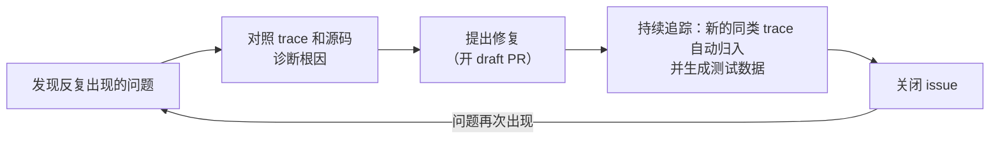
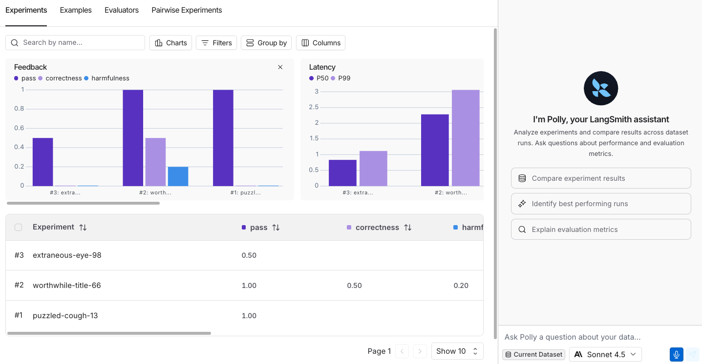
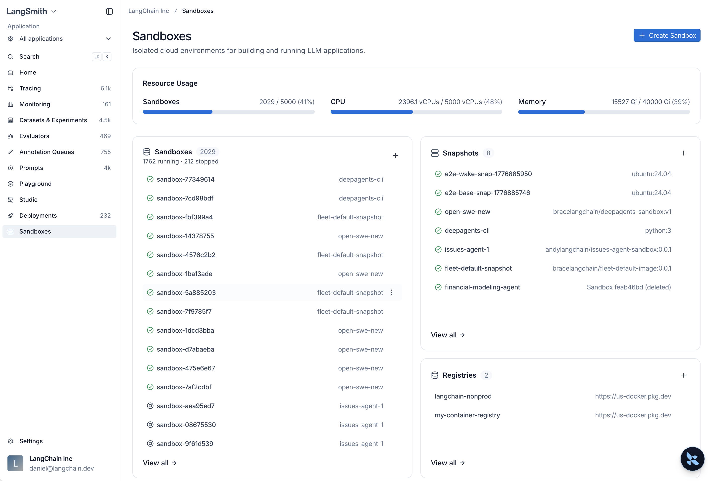

# 08 Engine、Chat、Sandboxes、LLM Gateway（简介）

> 来源：[Engine](https://docs.langchain.com/langsmith/engine) · [LangSmith Chat](https://docs.langchain.com/langsmith/chat) · [Sandboxes](https://docs.langchain.com/langsmith/sandboxes) · [LLM Gateway](https://docs.langchain.com/langsmith/llm-gateway) · 核实日期 2026-10-28

这四个都是比较新的功能：

| 功能 | 一句话 | 状态 |
|------|--------|------|
| **Engine** | 自动从线上 trace 里找出反复出现的问题，诊断根因，开 PR 修复 | 按 LSU 计费；部分子功能 Beta |
| **LangSmith Chat** | 内置 AI 助手（原名 Polly），在各个页面直接提问 | 需配置模型 key |
| **Sandboxes** | 让 agent 在隔离环境里执行代码、操作文件 | 各云区域 GA |
| **LLM Gateway** | 一个 LangSmith key 调所有模型，统一追踪和管控 | Beta |

---

## 1. Engine：自动排障

### 它做什么



Engine 定时扫描你的 tracing project（或 agent 环境），把问题聚类并按严重程度排序。每个 issue 包括：相关 trace、根因诊断、修复建议，以及从线上输入生成的**测试数据**（可以直接放进 [04 的离线评估](04_evaluation.md)，验证修复确实有效）。

### 值得知道的细节

- **优先看反馈差的 trace**：online evaluator 的低分、标注队列的评分、用户反馈都会被当作高优先级信号。所以先把 [05](05_online_eval_feedback.md) 配好，Engine 会更准。
- **会从你的操作中学习**：你关闭 issue、标记为 **Incorrectly Flagged**、调整优先级、开 PR，这些操作都会被总结成规则写进 agent overview 的 **User Preferences**，以后的扫描会参考这些规则。
- **连接 GitHub（可选但推荐）**：Engine 能读到源码时，诊断和修复会贴合你的实际实现。它只能**读你选定的仓库**和**开 draft PR**，**永远不会自己合并**。目前能提出代码修改的是用 Deep Agents、LangChain、LangGraph 写的 agent。
- **通知**：issue 可以推送到 Slack、Jira 或告警平台。
- **Beta 功能（仅 Cloud）**：**Fix validation** 重放 issue 相关的 trace，确认能复现、修复后不再出现；**Red Teaming** 在上线前用合成请求主动探测 agent。

### 费用

- 按 **LSU（LangChain Standard Unit）** 计费，**1 LSU = 1 美元**，消耗量取决于分析的 trace 数、诊断用到的模型调用、连接的代码仓库大小。
- **分析级别**：Reduced（便宜）/ Standard（默认）/ Expanded（流量大的项目才能选）。设置时会显示预估月费。
- **花费上限**：组织级默认 **750 LSU / 月**（管理员没设置时生效），也可以按项目设上限。到达上限后暂停新的扫描。

### 开启

在 tracing project 或 agent 环境里打开 **Engine** 标签页，按 [Set up Engine](https://docs.langchain.com/langsmith/engine-setup) 操作。

---

## 2. LangSmith Chat（原 Polly）

内置在 workspace 里的 AI 助手，**按 `Ctrl+I`（Mac 上 `Cmd+I`）打开**，会根据你当前所在的页面回答问题。


*图：Chat 侧边栏（来源：LangSmith Chat）*

| 所在页面 | 可以问 |
|----------|--------|
| 项目的 run 列表 | 「过去 24 小时失败的 run 有哪些？」「把失败的 run 加进测试集」 |
| 单个 trace | 「这次为什么失败？」「哪一步最慢？」「agent 哪里可以做得更好？」 |
| Threads | 「用户是不是不耐烦了？」「用户的问题解决了吗？」 |
| Engine | 「为什么标记了这个问题？」「解释一下修复方案」「最紧急的是哪个？」 |
| Playground | 「改成用意大利语回答」「语气更正式」，或者用 Optimize prompt、Generate a tool、Generate an output schema |
| 实验 / 数据集 | 「哪个实验最好？」「失败的例子有什么共同点？」 |
| 标注队列 | 「这次 run 出了什么问题？」「打分时要注意什么？」 |
| 评估器编辑器 | 「写一个检查幻觉的评估器」 |

**开始之前**：在 **Settings → Integrations → Provider secrets** 加一个模型 key。支持 Anthropic、OpenAI、Gemini、Bedrock、Groq、Mistral、xAI、DeepSeek、Fireworks；在 Playground 里配置的自定义模型打开 **Available in Chat** 后也能用。

---

## 3. Sandboxes：安全地执行 agent 生成的代码

agent 要跑代码、读写文件时，放在隔离的沙箱里执行，不影响你自己的机器和基础设施。

```python
from langsmith.sandbox import SandboxClient

client = SandboxClient()  # uses LANGSMITH_API_KEY

with client.sandbox() as sb:
    result = sb.run("python3 -c 'print(2 + 2)'")
    print(result.stdout)  # "4\n"
```


*图：Sandboxes 页面（来源：Sandboxes）*

- **可用范围**：GCP US / EU / APAC、AWS US、BYOC 都已 GA；自托管需要单独开启。
- **网络**：非 Enterprise 组织默认**限制出网**，只能访问常见的包仓库、代码仓库和模型 API；需要完全放开要提工单申请。
- **Snapshots**：从 Docker 镜像构建，或者保存一个运行中的沙箱，之后从它启动新沙箱。
- **Service URLs**：把沙箱里跑的服务暴露出来访问。
- **Sandbox CLI**：不写代码也能创建沙箱、执行命令、开交互式 shell。
- **接入 agent**：Deep Agents 可以直接用 `LangSmithSandbox` 作为执行后端；LangChain / LangGraph 也支持接 E2B、Daytona、Modal 等第三方沙箱。

---

## 4. LLM Gateway（Beta）

开发者只拿一个 **LangSmith API key**，就能调用 workspace 里配置好的所有模型提供商；每次调用都自动成为一条 trace，管理员可以统一设置**花费上限、限流、数据策略**。

```bash
curl https://gateway.smith.langchain.com/v1/chat/completions \
    -H "Authorization: Bearer $LANGSMITH_API_KEY" \
    -H "Content-Type: application/json" \
    -d '{"model":"anthropic/claude-sonnet-5-5","messages":[{"role":"user","content":"Hello!"}]}'
```

| 项目 | 说明 |
|------|------|
| 请求格式 | OpenAI Chat Completions（`/v1/chat/completions`）、Anthropic Messages（`/v1/messages`）、OpenAI Responses（`/v1/responses`），任何格式都能调任何已配置的提供商，网关会自动转换 |
| 模型 ID | `provider/model`，如 `openai/...`、`anthropic/...`、`azure/<deployment-name>`；自定义端点用 `custom/<name>` |
| 谁付模型费 | 用自己的提供商账号（管理员把 key 存进 Provider Secrets，账单走你的提供商）；或用 **Gateway Credits**（LangChain 提供，费用记在 LangSmith 账单上） |
| 前提 | 管理员先完成 [Administrator setup](https://docs.langchain.com/langsmith/llm-gateway-admin-setup) |

上面的 curl 是 US 区域的地址；BYOC 和自托管的路径前面要加 `/gateway`。Prompt Hub 里的 prompt 也能设置成通过网关调用模型。
