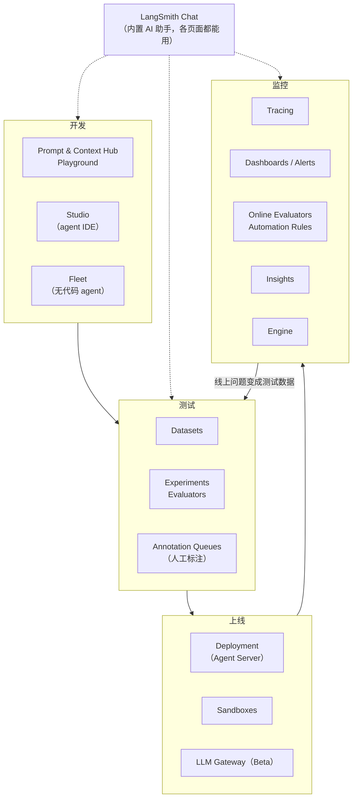
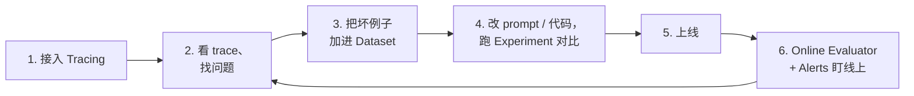
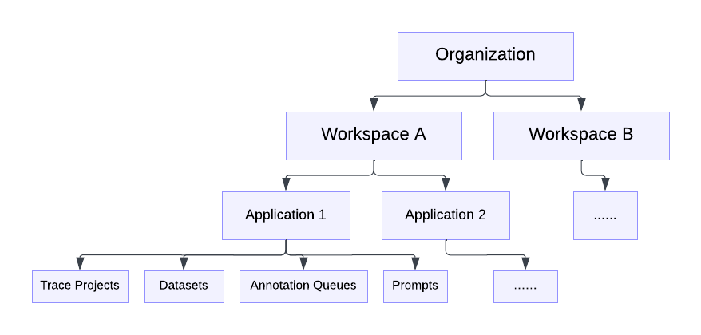

# LangSmith 功能总览与上手教程

> **核实日期**：2026-10-28 · **信息来源**：[LangSmith 官方文档](https://docs.langchain.com/langsmith) · **截图**：取自官方文档，版权归 LangChain，仅用于内部学习
>
> LangSmith 更新很快，名称和入口可能变化。看到和界面对不上的地方，以官方文档为准。

## LangSmith 是什么

[LangSmith](https://smith.langchain.com/) 是 LangChain 公司的 **agent 工程平台**，覆盖 agent 从开发到上线的整个周期：

- **看得见**：记录每次请求里每一步的输入、输出、耗时和花费（Tracing）。
- **量得出**：用数据集和评估器给 agent 打分，比较不同版本的好坏（Evaluation）。
- **改得快**：把 prompt 和上下文从代码里拿出来管理，改了不用重新部署（Prompt & Context Hub）。
- **跑得稳**：托管运行 agent，并在线上自动发现和定位问题（Deployment、Engine）。

它**不绑定框架**。用 LangChain / LangGraph 时，设一个环境变量就能开启追踪；用 OpenAI SDK、Anthropic SDK、Claude Agent SDK、Pipecat 或者自己写的代码，也有对应的包装器和装饰器。

## 产品全景

## 推荐的开发闭环

这个闭环的价值在于**每次改动都有数据证明是变好了还是变坏了**，而不是凭感觉。

## 功能清单

| 版块 | 能做什么 | 状态 / 套餐要求（文档中标明的） | 教程 |
|------|----------|-----------------|------|
| **Tracing（追踪）** | 记录每次请求的完整执行树；按 thread 串起多轮对话；过滤、搜索（含 AI 搜索 Beta）、成本统计、采样、敏感信息脱敏、批量导出 | — | [02](02_observability.md) |
| **Dashboards / Alerts** | 每个项目自动生成的预置看板；自定义图表；延迟、错误率、成本、反馈分数告警（可接 PagerDuty / webhook） | — | [03](03_monitoring.md) |
| **Insights** | 自动把大量 trace 聚类，总结用户在用什么、agent 在哪类问题上失败 | Plus / Enterprise | [03](03_monitoring.md) |
| **Custom Apps** | 在 LangSmith 里面跑你自己做的 UI（比如专用标注页面） | Plus / Enterprise | [03](03_monitoring.md) |
| **Evaluation（离线评估）** | Dataset + 目标函数 + 评估器 → Experiment；多个实验对比、回归标红；Pairwise 两两比较 | — | [04](04_evaluation.md) |
| **Online Evaluators** | 对线上 trace 自动打分：LLM-as-judge、代码、多轮对话、组合评估器 | — | [05](05_online_eval_feedback.md) |
| **Automation Rules** | 满足条件的 trace 自动进数据集 / 进标注队列 / 发 webhook / 延长保留期 | — | [05](05_online_eval_feedback.md) |
| **Feedback / Annotation Queues** | 用代码记录用户反馈；人工审核队列（单条、整段对话、A/B 两两比较） | — | [05](05_online_eval_feedback.md) |
| **Prompt & Context Hub** | prompt 版本管理（commit + tag），代码按名字拉取；Context Hub 管理技能和 agent 的指令包，按环境发布 | — | [06](06_prompt_engineering.md) |
| **Playground** | 在网页里改 prompt、换模型、对整个数据集跑一遍 | — | [06](06_prompt_engineering.md) |
| **Deployment** | 托管运行 agent（持久执行、流式输出、水平扩展），支持 LangGraph、Claude Agent SDK、CrewAI、Google ADK 等 | Cloud 需 Plus 及以上 | [07](07_deployment_fleet.md) |
| **Studio** | agent 的可视化 IDE：看图结构、逐步调试、time travel、一键部署 | 配合 Agent Server 使用 | [07](07_deployment_fleet.md) |
| **Fleet** | 无代码 agent 构建器，从模板起步、连接各类应用、可在 Slack 里用 | 自托管为 Beta | [07](07_deployment_fleet.md) |
| **Engine** | 定时扫描线上 trace，发现反复出现的问题，诊断根因，在 GitHub 上开 PR 修复 | 按 LSU 计费 | [08](08_engine_chat_sandbox.md) |
| **LangSmith Chat** | 内置 AI 助手（原名 Polly），在 trace、对话、实验、Playground 页面直接提问 | 需配置模型 API key | [08](08_engine_chat_sandbox.md) |
| **Sandboxes** | 隔离环境里安全执行 agent 生成的代码和文件操作 | 各云区域 GA | [08](08_engine_chat_sandbox.md) |
| **LLM Gateway** | 一个 LangSmith key 调用多家模型，统一追踪、限额、数据策略 | Beta | [08](08_engine_chat_sandbox.md) |
| **Remote MCP / CLI** | 让 Claude Code、Cursor 等 MCP 客户端直接读 LangSmith 数据；命令行查 trace | 所有云区域 | [02](02_observability.md) |

### 最近的改名（看老教程时注意）

| 旧名称 | 新名称 |
|--------|--------|
| Polly | **LangSmith Chat** |
| Agent Builder | **LangSmith Fleet**（2026-03） |
| Prompt Hub | **Prompt & Context Hub**（新增 Context Hub） |
| `LANGCHAIN_API_KEY` / `LANGCHAIN_PROJECT` | `LANGSMITH_API_KEY` / `LANGSMITH_PROJECT` |

## 先搞懂几个概念

*图：Organization → Workspace → 资源的层级（来源：[Administration overview](https://docs.langchain.com/langsmith/administration-overview)）*

| 概念 | 含义 |
|------|------|
| **Organization / Workspace** | 组织下面分多个工作区；API key、数据集、prompt 都属于某个工作区 |
| **Agent + Environment** | 新的工作区按「agent」组织 trace，每个 agent 分 4 个固定环境：`local`、`development`、`staging`、`production`。告警、看板、Insights 都可以只看 production |
| **Tracing project** | 老的组织方式（自托管版也是这种）：trace 按项目名归类 |
| **Trace / Run** | 一次完整请求叫 trace；里面每一步（LLM 调用、工具调用、检索）叫 run，run 可以嵌套 |
| **Thread** | 同一个会话的多个 trace，通过 metadata 里的 `thread_id` 或 `session_id` 串在一起 |
| **Dataset / Example** | 测试用例集合；每条 example 有 inputs，可选 reference outputs |
| **Experiment** | 用某个版本的应用把整个数据集跑一遍并打分的结果 |
| **Feedback** | 挂在 run 上的分数或评论，来源可以是用户、评估器或人工标注 |

> **怎么判断自己的工作区是哪种？** 看左上角的切换控件：显示 agent 的就是按 agent 组织，否则是按 project 组织。两种的环境变量写法不同，见 [01 快速上手](01_quickstart.md)。

## 套餐、保留期与限制（摘要）

| 项目 | 说明 |
|------|------|
| 免费额度 | Developer 套餐不绑卡时每月 5,000 条 trace |
| 数据保留 | 基础 trace 保留 **14 天**；扩展保留 **180 天**（2026-09-14 起 SaaS 的长期保留上限统一为 180 天） |
| 自动升级保留期 | 跑了 online evaluator 或被自动化规则选中延长保留的 trace，会自动升级为扩展保留，**费用更高** |
| 云区域 | GCP US（默认）、GCP EU、GCP APAC、AWS US；非 US 区域要设置 `LANGSMITH_ENDPOINT` |
| 部署形态 | Cloud（全托管）、BYOC（数据在你的 VPC）、Self-hosted（全部自己跑）；后两种需要 Enterprise |

具体价格经常变，以 [Pricing](https://www.langchain.com/pricing) 和 [Usage and billing](https://docs.langchain.com/langsmith/usage-and-billing) 为准。

## 阅读顺序

| 顺序 | 文档 | 类型 | 大约用时 |
|------|------|------|----------|
| 1 | [01 快速上手：第一条 trace](01_quickstart.md) | 手把手 | 10 分钟 |
| 2 | [02 Observability：看懂和用好 trace](02_observability.md) | 手把手 | 30 分钟 |
| 3 | [04 Evaluation：用数据集评估 agent](04_evaluation.md) | 手把手 | 30 分钟 |
| 4 | [06 Prompt & Context Hub](06_prompt_engineering.md) | 手把手 | 20 分钟 |
| 5 | [03 监控：Dashboards、Alerts、Insights](03_monitoring.md) | 操作指南 | 15 分钟 |
| 6 | [05 线上评估、自动化与人工标注](05_online_eval_feedback.md) | 操作指南 | 20 分钟 |
| 7 | [07 Deployment、Studio、Fleet](07_deployment_fleet.md) | 简介 | 10 分钟 |
| 8 | [08 Engine、Chat、Sandboxes、Gateway](08_engine_chat_sandbox.md) | 简介 | 10 分钟 |

所有代码示例都用 **Python + Anthropic Claude**。用 OpenAI 的话，把 `wrap_anthropic` 换成 `wrap_openai` 即可，其余写法一样。
